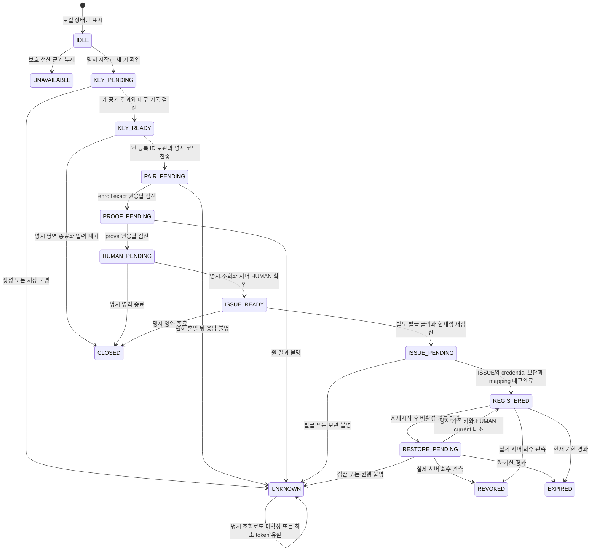

# FN06 desktop 소유 신뢰 등록 후보 — 2026-11-02

상태: DRAFT / 미채택 / 구현 GO 아님. Primary가 작성하고 Main이 검토·결정을 관리한다. 이 문서는 HUMAN 승인 기록이 아니다. A안을 권장하지만 아직 선택되지 않았다.

## 1. 목적·기존 근거

프로젝트·헌법·지식과 권위 이력은 Anvil에 남고 LLM·Agent·세션·계정은 교체 가능하다는 원칙을 따른다. 기존 Windows desktop main이 등록을 소유하고 LLM 계정에 키나 등록 관계를 묶지 않는 안이다.

- `docs/design/Anvil_v3_인터뷰_합의사항.md`: 사용자 소유 프로젝트·지식 보존과 최소 손실 교체.
- `docs/work_packages/FUNCTION_WORK.md` FN06: Windows 실행기·보호 인증 참조, 등록/인증/실제 시험 분리. 설치만으로 실제 지원이라 하지 않는다.
- `docs/contracts/INTERFACES.md` §12.2/14.3: outbound HTTPS·사용자 cookie와 실행기 credential 분리·일회 등록/HUMAN 지문 확인·목적 IPC와 패키지 신뢰.
- `docs/04_test_reports/AV3/P02/RESULT.md`: 상세 계약 수용이며 제품/실제 보안·DB 성공이 아니다.
- `docs/contracts/FN06_NATIVE_PREPARATION_AUTHORITY_CURRENT_CONSUME_CANDIDATE_20261102.md`: NATIVE_ONLY·등록 P256·현재 profile·원예산·consume 전 proof. STATUS_ONLY를 native 권위로 확대하지 않는다.

아래 기존 경로는 실제 목록·내용을 읽었다. 신규 IPC·저장 원형·위치는 후보이며 기존 구현으로 주장하지 않는다.

## 2. 실제 생산·소비와 누락

| 경로·심볼 | 현재 사실·누락 |
|---|---|
| `apps/desktop/src/main.cjs` → `shell.cjs:createShell` | 실제 Electron 진입점. 로컬 설정과 remote WebContentsView만 조립하며 등록 coordinator는 없음 |
| `apps/desktop/src/preload.cjs`, `policy.cjs:assertIpc` | 로컬 settings mainFrame에 get-state/connect/client-quit만 허용. 등록 IPC 없음 |
| `apps/desktop/src/settings.html`, `settings.js` | 서버 주소·연결/종료 UI만 존재 |
| `apps/web/src/features/connections/TrustPanel.tsx`, `trust-api.ts` | registerConnector·최초 pairing 코드·HUMAN 지문/범위 확인·회수. 로컬 키/enroll/prove/issue 호출0 |
| `apps/connector/security/secret-store.ts:WindowsProtectedStore` | createHostKey/publicHostKey/signHostProof와 평문 반환 없는 credential 보관/비교. 제품 root/helper/mapping 생산자 없음 |
| `apps/connector/runtime/windows-host.ts:invokeProtectedHost` | 기존 helper hash/path 검산과 고정 보호 연산 호출. 자체 10초/kill은 native 원예산 대체 불가 |
| `apps/connector/native/ProtectedStore.cs` | DPAPI CurrentUser `<keyId>.key` 저장/읽기. root는 argv, 기존 등록 목적만 서명 |
| `apps/connector/runtime/trust-https.ts:TrustHttpsClient` | enroll/prove/exchange/status wire는 존재하나 제품 조립 caller 없음 |
| `apps/connector/runtime/native-preparation-proof-signer.ts` | private 문맥·mapping 전후 동일성·P256·서명·원예산 검산. mapping.resolve/exchange 실제 공급자 없음 |
| `apps/connector/native/NativePreparationProofSource.cs:Sign` | 기존 CngKey를 받는 typed primitive. caller/root 인증·키 열기 없음 |

전체 예시 `tests/integration/FN06/windows-https-registration.test.ts:47~56`에서는 시험이 root/helper 경로·keyId를 정한다. 이는 제품 신뢰 근거가 아니다. 서버 등록 row는 공개 SPKI·지문·등록/connector 세대만 복원하며 local keyId/root를 알지 못한다.

## 3. 기존 채택과 이번 새 delta

기존 채택은 registerConnector/confirmConnectorRegistration/revokeConnector, enroll/prove/exchange의 정확 wire, 등록 proof와 native proof의 서로 다른 domain, 기존 DPAPI 키 형식, native 현재성·원 단조 deadline/고정 wall 상한이다. SIGN_PROOF를 범용 bytes/native 목적까지 확대하지 않는다.

새 delta는 ①로컬 설정 UX/privileged IPC ②제품 helper/root 최초 생산 ③keyId/root↔등록·세대/profile의 보호 mapping 수명/복구 ④별도 native 서명 entry의 보호 caller 조립이다. 새 DB/API/registry가 반드시 필요하다고 단정하지 않으며, 이 네 경계가 기존 leaf만으로 생산된다고도 보지 않는다.

## 4. 권장 정상 흐름과 원예산

1. 기존 Electron main이 local settings의 명시 시작을 받는다. remote WebContentsView에 Node/preload/일반 파일·키 IPC를 열지 않는다.
2. 고정 제품 helper와 보호 root 생산 근거를 검산한다. 근거 부재는 키 생성 전 UNAVAILABLE. renderer의 경로/hash/keyId 입력은 받지 않는다.
3. main이 내부 UUID keyId를 정해 기존 create-new 키 생성을 최대1회 호출하고 P256 공개키·지문을 검산한다. 실제 키 생성은 별도 실행 승인 전 미실행이다.
4. 공개 지문만 로컬 표시한다. 사용자가 기존 UI11에서 예상 지문을 직접 비교·입력해 HUMAN 등록 요청을 저장한다.
5. 최초 코드와 등록 ID를 사용자가 local settings에 명시 제시한다. 원 origin/attempt·공개키에 묶어 enroll→등록 proof→prove를 호출한다.
6. UI11에서 HUMAN이 서버 관측 지문·범위·기한을 명시 확인한다. 로컬 키 보유나 버튼이 이를 대신하지 않는다.
7. 로컬의 별도 명시 발급 동작이 새 challenge와 정확 등록 proof를 소비해 ISSUE한다. 원결과·등록·키·scope·현재 세대/기한 검산 후 보관 완료를 표시한다.
8. 동일 소유 등록 결과에서만 native key binding을 생산한다. 원 등록키·공개 지문·등록 세대·profile/current·별도 native 권위를 검산한다. 등록 완료는 native 준비/Agent 실행 허가가 아니다.

등록과 native의 예산을 혼합하지 않는다. native 서명은 기존 signer context의 동적 remaining·고정 callExpiresAt을 좁혀서만 전달한다. helper마다 새 10초0. consume 뒤 factory ticket을 consume 전 서명의 인증으로 재사용하면 순환이므로 금지한다.

## 5. 로컬 화면 후보

새 메뉴 없이 기존 local settings의 접힌 ‘이 PC 신뢰 등록’ 영역을 후보로 한다. 페이지 진입/열기만으로 IO·키·등록·교환0.

| 상태 | 표시·명시 버튼 |
|---|---|
| UNAVAILABLE | 보호 helper/root/current 근거 없음. 고정 사유·생성/발급 비활성 |
| IDLE | 등록 준비 시작·새 키 생성 확인 |
| KEY_READY | 공개 지문·지문 복사·등록 ID/일회 코드 입력 |
| PROOFED_WAITING_HUMAN | 서버 화면에서 지문 확인 필요·현재 상태 확인 |
| READY_TO_ISSUE | HUMAN 확인 관측·발급 요청 보내기 |
| REGISTERED | 원 등록 참조·기한·상태조회 전용. 실행 완료 표시0 |
| RESTORE_PENDING | A만 기존 등록 다시 확인. 자동 활성화0 |
| REVOKED / EXPIRED | 원 이력 보존·새 서명 차단. 새 등록은 별도 명시 확인 |
| UNKNOWN | 원 attempt 보존·자동 재발급/새 키/재전달0 |
| CLOSED | 입력/코드 폐기·진행 권위 회수. 외부 중지 완료 표시0 |

후보 입력은 UUID registrationId, 기존 canonical base64url43 oneTimeCode, 1..200자 label뿐이다. origin은 기존 명시 연결의 HTTPS origin을 main이 소비한다. actor/generation/keyId/root/helper/hash/profile/공개키를 renderer가 선택하지 않는다. profile 공급자 부재를 수동 입력으로 대체하지 않는다.

창 닫기는 기존 숨김 의미를 유지한다. 등록 영역 닫기·서버/remoteView 교체·인증 상실·회수는 epoch를 바꾸고 늦은 결과를 폐기한다. 출발한 ISSUE는 취소 성공으로 단정하지 않고 UNKNOWN을 보존한다. 오래된 finally가 현재 latch를 잠그거나 해제하지 못한다.

## 6. 닫힌 IPC 후보

기존 API가 아닌 새 후보다. own data property/exact keys만 허용하고 getter/prototype/extra/잘못된 길이를 거절한다. 소유 local settings sender+mainFrame+LOCAL_URL·현재 window/origin epoch를 main에서 검산한다. remote renderer/iframe/다른 창은 거절한다.

requestId/attemptId는 UUID, epoch는 양의 안전정수. main이 attemptId/epoch를 발급하며 renderer 선언은 권위가 아니다.

| 후보 IPC | exact 요청 | 효과 |
|---|---|---|
| trust-status | `{attemptId:null 또는 UUID,epoch:null 또는 양의정수}` | 로컬 상태만·네트워크/키 IO0 |
| trust-begin | `{requestId,epoch,confirmNewKey:true,label}` | 현재 고정 origin에서 신규 준비/키 생성 최대1회 |
| trust-pair | `{requestId,attemptId,epoch,registrationId,oneTimeCode}` | 원 enroll/prove만·자동 발급0 |
| trust-act | `{requestId,attemptId,epoch,action}` | action exact CHECK_CURRENT / ISSUE / RESTORE_VERIFY / CLOSE. RESTORE_VERIFY는 A만 |

성공 exact `{ok:true,state}`. state exact `{schemaVersion:1,attemptId,epoch,phase,origin,label,publicFingerprint,registrationRef,expiresAt,problem,recoveryAvailable}`. 미생산 선택값은 null, recoveryAvailable은 boolean. phase는 §5 enum, ref/ISO/hash는 기존 원형, publicFingerprint는 null/소문자SHA256이다. keyId/root/SPKI/credential/token/nonce/서명/일회 코드/raw helper 오류는 응답에 넣지 않는다.

실패 exact `{ok:false,error:{code}}`. 후보 code는 IPC_DENIED / INPUT_INVALID / CONTEXT_CHANGED / BUSY / PROTECTION_UNAVAILABLE / SERVER_REJECTED / DEADLINE / OUTCOME_UNKNOWN / RESTORE_UNAVAILABLE. 구체 서버 오류 표시 whitelist는 기존 wire와 추가 검토 필요이며 raw 통과0이다.

같은 requestId는 같은 exact 요청의 원결과만 조회한다. ISSUE 재전송0. 일회 코드는 저장/로그/재조회0. 재시작 뒤 미완료 요청을 성공으로 복원하지 않는다. renderer의 epoch 일치만으로 키 사용 허가를 주지 않는다.

## 7. helper/root 최초 생산의 아직 없는 선행

제품 helper 배치와 root 초기화 producer는 현재 없다. 아래는 새 검토 대상이다.

- main이 userData 아래 제품 전용 고정 하위 위치를 선택하는 안. 정확 basename·ACL·최초 생성/동일 사용자 확인·migration은 미정이다. server-origin.json/QA protected 경로를 자동 재사용하지 않는다.
- helper는 고정 build 입력/검산 산출물에서만 선택한다. 임의 파일을 hash해 그 값을 기대 hash로 삼지 않는다. 별도 ProtectedStore/native signer helper의 실제 포장·FN18 연결은 후속 설계 대상이다. owner helper의 hash/ref가 signer까지 자동 인증하지 않는다.
- absolute/nonlink/realpath/소유·companion/env/cwd·원 부모/channel 검산을 명시한다. 일반 Node PID/JSON/hash 하나로 보호 부모나 완전 TOCTOU 방어를 주장하지 않는다.
- keyId는 main 생성 UUID로 기존 CREATE_KEY create-new를 소비한다. 파일 주소이지 인가가 아니다. 기존 DPAPI .key 형식은 유지하며 개인키를 Node/renderer로 반환하지 않는다.
- native 별도 entry는 보호 binding이 선택한 기존 키만 열어 purpose/authority/request/지문을 재검산한다. 범용 bytes/root JSON 서명기를 만들지 않는다.

이 선행 부재 상태에서는 UI/constructor 존재만으로 준비 가능 true를 생산할 수 없다.

## 8. A/B 저장·복구 선택

| 항목 | A 보호 지속 mapping·명시 재확인 복구 — 권장 | B 휘발 binding |
|---|---|---|
| 재시작 | 보호 기록/원 키/등록/current를 명시 재확인 후 재사용 | UNAVAILABLE. 원 키가 남아도 자동 연결0 |
| 손실 | 등록 관계 손실과 불필요 재등록 최소화 | 중단 후 복구 미구현 |
| 새 경계 | 보호 metadata·원자성·회수·복구 계약 필요 | 저장 계약 작지만 복구 약속 불가 |
| 원복 | 활성화 차단·원행 보존 후 명시 회수/정리 | 메모리 폐기. 서버 회수/파일 정리 성공 아님 |

A record 후보 exact: `{schemaVersion:1,purpose:'DESKTOP_TRUST_KEY_BINDING',bindingId,revision,previousHash,origin,installationId,keyId,rootBindingId,helperImageHash,publicKeySpki,fingerprint,registrationRef,connectorRef,scopeDigest,registrationGeneration,channelProfileRef,state,createdAt,expiresAt}`.

state는 PENDING / REGISTERED / REVOKED / UNKNOWN, previousHash는 최초 null/후속SHA256. ID는 UUID, refs는 기존 fullref, 시간은 기존 밀리초 UTC ISO, SPKI는 기존 P256 canonical base64url, origin은 기존 2048자 이내 정규 HTTPS다. 양의 세대/revision은 안전정수. channelProfileRef는 미결박이면 null이고 null로 native 허가 생산0. 이 record와 각 필드 authoritative producer는 새 검토 대상이다. PENDING 단계 nullable ref/세대의 정확 조합은 아직 미정이며 가짜 ref로 채우지 않는다.

rootBindingId는 실제 root 소유 객체와 연결할 후보 식별자이지 경로 자기선언이 아니다. 구체 생산/보관 형식은 미정이고 새 registry 필수를 뜻하지 않는다. record의 유한 bytes/개수·이력/CAS·포화·잘림/동기화 실패·동시 writer 규칙은 구현 전 확정해야 한다.

기존 DPAPI 키/credential 형식은 유지한다. A metadata도 CurrentUser 보호·원자 create/write/sync/readback을 후보로 하되 같은 사용자 악성 코드 전체 방어/antirollback을 DPAPI만으로 보장하지 않는다. 새 파일 목적/ACL은 이 문서만으로 실행 승인되지 않는다.

mapping에는 코드·서명·challenge·cookie/CSRF·NATIVE_ONLY opaque secret을 저장하지 않는다. 기존 StatusOnly credential 저장과 native slot을 혼용하지 않는다. ‘비밀 비저장’은 mapping/로그/UI에 해당하며 기존 보호 개인키 파일이 없다는 뜻이 아니다.

A 복구는 명시 동작으로 공개키 재산출↔지문/SPKI↔원 등록 ref/세대/scope↔현재 허가/profile를 대조한다. 만료/회수/옛 세대·다른 사용자·키/root 부재·변조·조회 불명은 비활성/UNKNOWN이다. 자동 재생성/재발급/새 등록0, 서버 이력/프로젝트 자료 보존. 단순 파일/옵션 읽기로 권위를 복원하지 않는다.

## 9. 불명·원복·검증

키 생성 응답 유실은 UNKNOWN, 같은 keyId CREATE_KEY 재시도0. ISSUE 유실은 기존 ALREADY_ISSUED_RECONCILE 의미를 유지하고 최초 token 재조회/재발급0. mapping 보관 실패는 발급 실패로 위장하지 않으며 원 키·등록을 보존해 명시 대조/회수로 전환한다. 과거 성공과 새 서명 현재성은 분리한다.

합성 검증 후보는 실제 local IPC→main coordinator→명시 fake host/HTTPS→기존 HUMAN 확인→원결과/mapping→native signer의 한 정상 흐름과 sender/ABA·root/키 치환·scope/세대/profile 변경·지문 불일치·동시 ISSUE·원예산/늦은 IO·재시작/잘림/보관 실패·비밀 비노출이다. wrapper PASS를 제품 등록 완료로 합산하지 않는다. 실제 키/DPAPI/helper/컴파일/TLS/DB/OS/서비스/Agent는 별도 승인·실행 전 NOT_RUN이다.

## 10. 승인 준비 판정

A를 권장하는 이유는 사용자 등록 관계를 LLM/Agent 수명에서 분리하고 재시작 손실을 줄이기 때문이다. 그러나 아직 구현 가능한 완결 계약은 아니다. 검토에서 다음을 닫아야 한다.

1. A/B 선택과 A의 nullable 조합·세대/ref 중복 의미·한도/CAS·원자 저장/손상·antirollback 한계.
2. 제품 root/helper 보호 producer·별도 signer startup/포장·부모/channel 기준. 기존 source로 생산됐다고 간주 금지.
3. 로컬 privileged IPC·상태/오류·원 서버 확인/발급 분리의 최종 원형.

후보 채택/source 구현 승인과 실제 키/파일 생성·ACL·DB/권한·서비스·컴파일/helper/Agent 실행 승인은 분리한다. 본 문서 작성으로 실제 동작은 승인/수행되지 않았다. 전체 FN06/계획은 미완료다.

## 11. r2 재정의 — 결정 후보 상세 원형

r2 상태도 DRAFT / NOT_ADOPTED다. 부모 r1 SHA256은 `7DCEA96A86836419183EC96AADBF9945600AFA176CEFF727783D2F99395A58D2`다. §1~10은 r1 검토 이력이며 아래 §11~17이 겹치는 후보 원형·미정 표현을 대체한다. 새 코드/키/저장/권한·실제 실행 승인이 아니다.

### 11.1 실제 응답으로 확인한 참조 의미

`apps/server/modules/connections/registration-protocol.ts`의 #view/enroll/prove/exchange/status와 `project-registrations.ts`의 registrationRef/connectorRef를 대조했다.

- enroll 성공 exact는 `{status:'HOST_PROOF_REQUIRED',registrationRef,connectorRef,scopeDigest,grants:[],executionAuthorized:false,challenge:{id,payload}}`다.
- prove 성공은 `{status:'PROVED_WAITING_CONFIRMATION',registrationRef,connectorRef,scopeDigest,grants:[],executionAuthorized:false,observedHostFingerprint}`다.
- CHALLENGE 성공은 `{status:'EXCHANGE_PROOF_REQUIRED',registrationRef,connectorRef,scopeDigest,grants:[],executionAuthorized:false,challenge:{id,payload}}`다.
- ISSUE 성공은 `{status:'ISSUED',registrationRef,connectorRef,scopeDigest,grants:[],executionAuthorized:false,scope:'REGISTRATION_STATUS_ONLY',credentialId,credential,expiresAt}`다. credential은 최초 응답의 기존 av3ct1 형식이며 expiresAt은 credential 기한이다. 등록 자체 기한과 다르다.
- status 성공은 `{connectorId,registrationId,generation,status:'REGISTERED_STATUS_ONLY',scope:'REGISTRATION_STATUS_ONLY',publicKeyFingerprint,expiresAt,grants:[],executionAuthorized:false,observedAt}`다. status에는 fullref가 없다. status만 보고 등록 개정 fullref를 만들지 않는다.
- registrationRef.version은 등록 상태 개정, connectorRef.version은 connector generation이다. registrationGeneration 중복 필드는 r2에서 제거한다. native authority credentialGeneration과도 혼동하지 않는다.
- registrationRef hash는 기존 `{registrationId,version,state,scopeDigest}`, connectorRef hash는 기존 `{connectorId,registrationId,scopeDigest,generation}`의 canonical hash다. 원 서버가 준 fullref를 원문과 대조해 보관하며 임의 생성한 scope/상태로 채우지 않는다.

challenge/nonce/서명/코드/raw credential은 mapping에 저장하지 않는다. 공개 refs가 있는 응답과 없는 응답의 차이를 유지한다. 기존 TrustHttpsClient.readProtocolReply는 공통 false/grants만 검산하므로 새 coordinator에서 각 단계 exact DTO·refs/hash/원키/원 ID 검산을 추가해야 한다. 현재 leaf의 호출만으로 이 검산이 이미 있다고 표시하지 않는다.

## 12. 소유 main·전용 helper·root의 구체 생산 후보

### 12.1 서명 선행인가와 원 factory의 분리

소유자는 기존 Electron main이다. local settings IPC sender 검산→main private attempt/binding→고정 전용 signer child의 직접 소유 pipe→C# typed 키 연산 순서다. native factory ticket은 이 선행인가에 넣지 않는다. 현재 `NativePreparationOwnerHostSource`/Peer는 OPEN/QUERY/CLOSE 원 owner 용도이며 서명 entry를 제공하지 않는다.

전용 신규 internal purpose 후보는 `DESKTOP_TRUST_KEY_OPERATION_V1`, signer 물리 namespace 후보는 `ANVIL_DESKTOP_TRUST_SIGNER_V1`다. 이는 기존 `ANVIL_NATIVE_OWNER_FACTORY_V1` ref의 재해석이나 새 서버 factory 등록이 아니다. 기존 authority.scope.nativeFactoryRef는 원 native owner 이미지를 계속 가리킨다.

### 12.2 빌드 producer→검산→사용

후보 producer는 기존 FN18 `verifyPackageForMaker`/`verifyPackageHardening`의 실제 exe/ASAR/header 관측과 동일 불변 package snapshot을 먼저 고정한다. 그 부모 basis를 전용 signer helper resource에 넣어 정상 compile 입력을 만든다. 새 signer source closure는 기존 ProtectedStore의 고정 키 연산·NativePreparationProofSource typed primitive와 새 전용 entry/부모-basis/peer caller 조립이다. QA ProtectedStore.Main을 제품 entry로 그대로 사용하지 않는다.

후보 resource exact는 `{schemaVersion:1,purpose:'DESKTOP_TRUST_SIGNER_PARENT_BASIS',namespace:'ANVIL_DESKTOP_TRUST_SIGNER_V1',signerId,signerVersion,parentExeHash,parentAsarHash,parentHeaderHash}`다. 최대8KiB·동일 assembly의 정확 이름1개·embedded/manifest-contained·external file/assembly0. private 선언은 compiler 옵션과 최종 helper 전체hash에서 검산할 build 조건이며 CLR runtime에서 조회했다고 주장하지 않는다.

전용 build 입력은 /main 전용 entry·/resource 고정 이름/private·고정 source closure·compiler/reference bytes·cwd·부모 snapshot을 결박한다. 최종 PE/CLI/resource data 판독과 helper 전체hash를 고정한 불변 descriptor를 desktop packaging이 소비한다. descriptor는 renderer/환경/일반 외부 manifest에서 선택하지 않는다. 부모 package 먼저→basis 내장 signer helper→최종 helper 전체hash의 단방향 순서다. 부모 ASAR 안에 미래 helperhash를 넣는 순환은 만들지 않는다. 고정 설치 이미지 descriptor가 실제 승인 package 출처에서 공급되지 않으면 기본 미등록이다.

main 사용선은 package 공급자→정확 descriptor→직접 소유 child→정확 요청 하나다. helper startup은 자기 resource와 자기 전체hash/설치 descriptor 관계, stdin/stdout Windows pipe peer의 동일 PID·보유 parent process 시작시각/실image·FN18 부모 exe/ASAR/header 관측을 교차검산한다. 기존 OwnerPeer의 원 kernel 관측 알고리즘·late IO 보존을 재사용할 수 있지만 purpose/기준 데이터와 entry는 분리한다. raw frame/keyId/root/PID/hash가 보호 startup 기준을 선택하지 않는다. 실행중 메모리/loaded ASAR 전체 또는 같은 사용자 모든 주입을 완전 입증한다고 주장하지 않는다.

helper에는 allowlist OS 최소환경 새 객체·고정 helperdir cwd·overlapped stdio·companion-free profile을 적용하는 후보를 제시한다. 임의 환경 상속/프로파일러·외부 config·새 환경 root 선택0. 이 모두는 새 signer producer의 source 구현 대상이며 기존 owner 구현이 signer에 적용됐다고 가정하지 않는다.

### 12.3 제품 root 생산 후보

경로는 renderer/환경변수/app userData 옵션에서 받지 않고 Windows `FOLDERID_LocalAppData`의 현재 사용자 KnownFolder 관측을 직접 소비해 `<LocalAppData>\Anvil\Trust\v1`로 고정하는 A 후보를 권장한다. 기존 코드에는 이 producer가 없다. 실제 KnownFolder/kernel SID 관측·최초 생성·ACL 실행은 이번 문서 작성 밖이다.

고정 root producer는 current token 사용자 SID와 KnownFolder 소유 SID, 각 부모/root nonlink/reparse 여부·정규 절대경로·보유 handle identity를 관측한다. root가 기존이면 해당 사용자 소유/기대 ACL·파일형식/링크수·동일 handle을 확인하며 소유 불명/일반 디렉터리를 자동 수리하거나 채택하지 않는다. 최초 생성은 명시 시작 후 사용자와 SYSTEM 전용 DACL 후보로 create-new하고 handle로 재검산한다. 구체 DACL 상속·관리자/기업 환경 호환은 새 보호 계약 검토 대상이며 ‘CurrentUser DPAPI니까 소유 검산 완료’로 줄이지 않는다.

root 경로 문자열은 renderer 응답/저장record에서 제거한다. helper는 보호 startup을 마친 뒤 자기 KnownFolder/current SID에서 동일 고정 root를 도출한다. main과 helper가 관측한 root volume/file identity·owner SID는 private 비교에만 쓴다. 별도 root registry/key/원격 선택0. `<keyId>.key`의 기존 DPAPI entropy/CurrentUser 형식은 그대로다. helper는 전용 typed 연산에서만 이 root 아래 원 keyId를 사용한다.

필요 새 producer는 전용 signer build/설치 descriptor, KnownFolder/SID·root 검산, 직접 소유 peer/entry다. 파일명만 만들거나 verified:true를 전달하는 것으로 대체하지 않는다. 이 후보를 선택해도 실제 설치/생성/ACL 실행은 별도 승인이다.

## 13. A 보호 record와 단계별 exact 저장

r1 §8의 단일 평면 record는 아래로 대체한다. plaintext logical record exact:

`{schemaVersion:1,purpose:'DESKTOP_TRUST_KEY_BINDING',bindingId,revision,previousHash,attemptId,origin,label,key,registration,credential,profile,state,uncertainStep,createdAt,updatedAt}`

- bindingId/attemptId UUID, revision 양의 안전정수, previousHash는 revision1에서 null/그 뒤 바로 이전 logical record의 SHA256. state는 아래 표 enum이다.
- origin은 기존 정규 HTTPS origin·최대2048자, label 1..200자, 시간은 밀리초 UTC ISO이며 createdAt≤updatedAt다.
- key는 null 또는 exact `{keyId,publicKeySpki,fingerprint,signerImageHash}`. UUID keyId·기존 canonical P256 SPKI/지문·고정 signer 전체hash다. rootBindingId/임의 path는 제거한다. 개인키/보호 blob은 넣지 않는다.
- registration은 null 또는 exact `{registrationId,registrationRef,connectorRef,scopeDigest,installationId,lastServerState,registrationExpiresAt}`. registrationId는 사용자 제시 원 UUID를 보존한다. refs/scope/installation/time은 아직 검산 응답이 없으면 아래 규칙에 따라 null이다. lastServerState는 null 또는 실제 조회 원형 CREATED/CHALLENGED/PROVED_WAITING_CONFIRMATION/CONFIRMED/ISSUED/REVOKED다. status의 REGISTERED_STATUS_ONLY를 등록 state로 넣지 않는다.
- credential은 null 또는 exact `{credentialId,digest,expiresAt,storageState}`. storageState exact STORED/STORE_UNKNOWN. 기존 StatusOnly credential의 공개 주소·digest/기한만 보관하며 av3ct1 원문은 별도 기존 DPAPI 저장 경로에만 최대1회 전달한다. 새 native secret 저장은 아니다.
- profile은 null 또는 exact `{channelProfileRef,expiresAt}`. 실제 보호 producer가 원 binding과 교차검산한 native profile만 넣는다. 등록 절차 완료만으로 profile을 채우지 않는다.
- uncertainStep은 null 또는 KEY_CREATE/ENROLL/PROVE/ISSUE/CREDENTIAL_STORE/MAPPING_STORE. native 불명 결과를 이 등록 상태로 섞지 않는다.

| state | key | registration | credential / profile | 추가 규칙 |
|---|---|---|---|---|
| KEY_PENDING | null | null | 모두 null | KEY_CREATE 시작 전 내구 기록. 원 결과 불명이면 UNKNOWN |
| KEY_READY | 필수 | null | 모두 null | 키 public 결과 검산·보관 완료 |
| PAIR_PENDING | 필수 | ID만 필수, 나머지 null 허용 | 모두 null | 코드 비저장, ENROLL 전 원ID 내구 보관 |
| PROOF_PENDING | 필수 | 원 enroll refs/scope/installation/기한 필수 | 모두 null | 원 payload 검산으로 installation/기한 고정. challenge 자체는 비저장 |
| HUMAN_PENDING | 필수 | prove 원refs·scope·installation·기한 필수 | 모두 null | 서버 HUMAN 확인을 기다림 |
| ISSUE_READY | 필수 | 보호 HUMAN current에서 CONFIRMED 관측·refs 등 필수 | 모두 null | 저장 상태만으로 ISSUE 허가를 복원하지 않음 |
| ISSUE_PENDING | 필수 | 위와 동일 | null | ISSUE 전 내구 전이. 재시작시 자동 ISSUE0 |
| REGISTERED | 필수 | 원 ISSUE refs·ISSUED·원등록기한 필수 | STORED 필수 / profile은 null 허용 | StatusOnly 이력 완료이며 현재 활성은 별도 조회 |
| REVOKED | 필수 | 보호 current REVOKED 원행 필수 | 과거credential 유지/null, profile null | 기존 credential/키 파일 자동삭제0 |
| EXPIRED | 필수 | 마지막 검산값 보존 | 과거credential 유지/null, profile null | 로컬 시간만으로 서버회수 완료 주장0 |
| UNKNOWN | 이전 원행의 필드만 보존 | 원 ID/관측값 보존 | 과거 필드 유지, STORE_UNKNOWN 허용 / profile null | uncertainStep 필수·가짜 refs/token 생성0 |

registration 객체가 ID만 있는 단계는 registrationRef/connectorRef/scopeDigest/installationId/lastServerState/registrationExpiresAt 모두 null이다. enroll 검산 후에는 모두 nonnull로 함께 고정한다. 후속 응답은 registrationId 동일·connector id와 generation 동일·scopeDigest/installation/키 동일을 검산하고 registrationRef 개정만 실제 응답에 맞춰 갱신한다. 같은 id/version 다른hash는 거절한다. server status에는 fullref가 없으므로 status를 받아 마지막 refs를 최신처럼 바꾸지 않는다. registrationRef 개정 상승은 실제 보호 조회 또는 원응답만 소비한다.

credential store 성공 전에 REGISTERED0. ISSUE 성공 뒤 credential 보관 불명이면 UNKNOWN/CREDENTIAL_STORE로 원 ISSUE refs를 보존한다. token이 유실됐으면 새 ISSUE/새키0. profile이 null이면 native signer mapping은 UNAVAILABLE이며 StatusOnly 파일을 native bearer로 사용하지 않는다.

### 13.1 유한 파일/CAS/원자성과 보존

A 후보는 새 root 안의 단일 `bindings.v1` 보호 컨테이너다. 최대16MiB encrypted bytes·최대1024 logical revision rows·각canonical record16KiB를 모두 적용한다. live만 세어 이력한도를 피하지 않는다. root metadata의 정확 파일명은 `bindings.v1`, `bindings.v1.previous`, 단발 create-new `bindings.v1.next`, `bindings.v1.lock` 네 개뿐이다. 기존 `.key`/기존 credential 파일은 별도 목적이며 개수/총bytes를 별도1024개/16MiB로 제한한다. 자동 순환삭제/포화용 회수예약0. 포화는 회수 사실의 새 로컬 기록도 거절할 수 있으며 서버현재성은 별도로 차단한다. 원행 조회는 보존한다.

컨테이너 plaintext exact `{schemaVersion:1,purpose:'DESKTOP_TRUST_BINDINGS',sequence,previousHash,rows}`. rows는 불변 revision 원형, 이전행 수정/축약0. current는 동일 binding의 최대revision이되 연속/previousHash를 전수검산한다. 새 revision은 정확 이전 container hash/sequence와 binding revision을 CAS한다. 하나의 main writer가 create-new lock을 보유하고 stale lock 자동탈취0. 다른 프로세스/소유/불명은 BUSY/UNKNOWN으로 닫는다.

DPAPI CurrentUser로 새 metadata 목적 entropy를 구분해 protect한다. write-next→동일 handle sync→길이/hash·DPAPI unprotect/canonical 관계 readback→고정 원본 CAS 재검산→same-volume 원자 replace(이전본보존)→directory/원본 readback까지 성공 후만 내구완료다. 구체 Windows replace/directory durability 보장 범위는 후속 source/실행 검증에서 확인하며 전원손실 안전을 문서로 PASS하지 않는다. 실패시 원본/previous/next를 자동 삭제하지 않고 UNKNOWN으로 보존한다. 실제 수정 전 owner/handle/root를 재검산한다.

재시작은 root/모든 고정파일 형식·상한·DPAPI/chain/CAS 관계를 먼저 검산한다. 원본 손상 때 previous를 자동 최신으로 채택하지 않는다. rollback 가능한 DPAPI 파일만으로 antirollback을 보장하지 않는다. 원 server current·새 generation 대조가 가능해야 새 서명으로 진행하며 오프라인은 비활성이다. 서버에서 증명 불가능한 로컬 chain 최신성은 한계로 표시한다.

## 14. 재시작·HUMAN current·credential의 분리

A의 재시작은 ‘기록 발견’만 표시한다. KEY_PENDING/PAIR_PENDING/PROOF_PENDING/ISSUE_PENDING/UNKNOWN을 자동 진행하지 않는다. 코드·challenge/nonce가 저장되지 않으므로 이를 재구성하거나 원 ISSUE를 재송신하지 않는다. 키 생성 불명은 원 keyId의 public 조회만 명시 수행하고 create 재호출0. 원등록을 HUMAN이 회수/대조하기 전 새 binding/key를 자동 만들지 않는다.

HUMAN_PENDING/ISSUE_READY/REGISTERED도 명시 복구에서 기존 로그인된 remoteSession과 고정 origin/project의 기존 HUMAN 등록 보호 GET으로 현재 OWNER/control/readpolicy·원 registrationId/키/범위/세대를 다시 확인한다. cookie/CSRF를 renderer에서 main으로 export하는 새 평문 API를 만들지 않는다. main이 해당 session의 고정 상대 endpoint만 요청하는 transport 조립은 새 source 작업이며 현재 구현돼 있다고 주장하지 않는다. transport 또는 로그인 부재면 RESTORE_UNAVAILABLE이다. renderer가 준 snapshot을 현재 보호 응답으로 신뢰하지 않는다. 새 서버 API는 제안하지 않는다.

REGISTERED 복구는 publicHostKey로 기존키 지문을 재산출·HUMAN 원행/current 대조 후 local mapping을 활성 후보로 만들 수 있다. 기존 credentialMatches만으로 bearer HTTP status를 호출할 수는 없다. 이 후보는 새 plaintextRead API를 추가하지 않는다. StatusOnly credential을 재시작 후 실제 네트워크에 재사용하려면 별도 보호 use-without-return producer가 필요하므로 이번 A 복구의 완료 조건에 넣지 않는다. 그 credential의 현재 활성은 미확인 표시한다. native는 별도 opaque slot/보호 profile/current/purpose가 충족될 때만 가능하며 A mapping 복구만으로 가용성을 표시하지 않는다.

REVOKED/EXPIRED/UNKNOWN의 원행·키/credential은 사용자 원복/감사를 위해 보존한다. 서버 회수는 기존 HUMAN revoke 명령으로 수행하고 로컬 삭제와 구분한다. 기록 포화/손상으로 로컬 전이가 실패해도 현재 서버 회수를 무효화하지 않으며 새 서명은 닫는다. 명시 제거는 소유/참조/정리 계획을 별도 확인해야 하고 본 문서는 삭제 실행을 허용하지 않는다.

## 15. IPC r2 닫힌 요청·응답·오류

§6의 상태/원형을 아래로 대체한다. 네 method와 exact 요청 keys는 유지한다. trust-begin의 epoch는 trust-status에서 main이 반환한 현재 contextEpoch여야 한다. 최초 status 입력은 `{attemptId:null,epoch:null}`뿐이다. 나머지 요청은 정확 attemptId/epoch, 고정 origin/window/인증 관측 epoch와 맞아야 한다. CHECK_CURRENT/ISSUE/RESTORE_VERIFY는 renderer가 URL/path/actor/token/세대를 전달할 수 없다.

성공 exact `{ok:true,state}`. state exact `{schemaVersion:1,contextEpoch,attemptId,phase,origin,label,publicFingerprint,registrationId,registrationRef,connectorRef,registrationExpiresAt,credentialExpiresAt,problem,recoveryAvailable}`. contextEpoch 양의안전정수, phase enum은 §5와 같되 KEY_PENDING/PAIR_PENDING/PROOF_PENDING/ISSUE_PENDING을 BUSY 표시로 합치지 않고 해당명으로 추가한다. 저장 state와 화면 phase가 다른 경우 HUMAN_PENDING→PROOFED_WAITING_HUMAN, ISSUE_READY→READY_TO_ISSUE다. 복구 발견은 RESTORE_PENDING, 닫기는 CLOSED, 진행 attempt 없는 상태는 IDLE/UNAVAILABLE다.

| phase군 | attemptId/label | publicFingerprint | registrationId/fullrefs | 기한 | problem/recoveryAvailable |
|---|---|---|---|---|---|
| IDLE/UNAVAILABLE | 모두 null | null | 모두 null | 모두 null | IDLE null/false, UNAVAILABLE PROTECTION_UNAVAILABLE/false |
| KEY_PENDING | 필수 | null | 모두 null | 모두 null | null/false |
| KEY_READY | 필수 | 필수 | 모두 null | 모두 null | null/false |
| PAIR_PENDING | 필수 | 필수 | ID 필수·refs null | 모두 null | null/false |
| PROOF_PENDING/PROOFED_WAITING_HUMAN/READY_TO_ISSUE/ISSUE_PENDING | 필수 | 필수 | 모두 필수 | 등록기한 필수·credential null | null/false |
| REGISTERED | 필수 | 필수 | 모두 필수 | 모두 필수 | null/false. 현재 활성은 이 phase가 보장하지 않음 |
| RESTORE_PENDING | 보관값 필수 | 보관 key 있으면 값/아니면 null | 원 보관 null조합 그대로 | 원 보관값 그대로 | RESTORE_UNAVAILABLE 또는 null/true. true는 명시복구 버튼 가능이지 권위복구 성공 아님 |
| REVOKED/EXPIRED | 필수 | 필수 | 원 보관값 그대로 | 원 보관값 그대로 | CONTEXT_CHANGED 또는 DEADLINE/false |
| UNKNOWN | 원 보관값 그대로 | 원 보관값 그대로 | 원 보관값 그대로 | 원 보관값 그대로 | OUTCOME_UNKNOWN/false |
| CLOSED | attemptId만 유지·label null | null | 모두 null | 모두 null | null/false |

origin은 main에서 고정한 연결이면 값, 미연결이면 null이다. phase의 데이터가 부족하면 가짜 refs를 채우지 않고 UNKNOWN/UNAVAILABLE을 선택한다. problem은 null 또는 다음 닫힌 code. pending field/코드/서명/credential/SPKI/keyId/root/helper 경로는 UI 응답0이다.

오류 exact `{ok:false,error:{code}}`. IPC_DENIED, INPUT_INVALID, CONTEXT_CHANGED, BUSY, PROTECTION_UNAVAILABLE, SERVER_REJECTED, DEADLINE, OUTCOME_UNKNOWN, RESTORE_UNAVAILABLE 외 허용0. 서버→로컬 분류 whitelist:

- CONNECTOR_HUMAN_CONFIRMATION_REQUIRED → SERVER_REJECTED, 기존 HUMAN 대기 유지. 자동 ISSUE0.
- CONNECTOR_REGISTRATION_NOT_PENDING/CONNECTOR_ENROLLMENT_ALREADY_USED/CONNECTOR_CHALLENGE_EXPIRED/CONNECTOR_CHALLENGE_NOT_PENDING/CONNECTOR_PROOF_NOT_PENDING/CONNECTOR_PROOF_ATTEMPT_LIMIT/CONNECTOR_FRESH_CLIENT_NONCE_REQUIRED/CONNECTOR_HOST_OR_CODE_MISMATCH/HOST_PROOF_INVALID/CONNECTOR_PROTOCOL_INPUT_INVALID/INPUT_INVALID → SERVER_REJECTED. 원 입력/record 보존.
- CONNECTOR_BASIS_NOT_CURRENT/CONNECTOR_CREDENTIAL_INVALID/CONNECTOR_CREDENTIAL_SCOPE_DENIED/CONNECTOR_CREDENTIAL_REQUIRED/NOT_FOUND/AUTH_REQUIRED → CONTEXT_CHANGED. 현재 접근 폐기.
- ALREADY_ISSUED_RECONCILE/CONNECTOR_EXCHANGE_RECONCILE_REQUIRED → OUTCOME_UNKNOWN. 자동 재발급0.
- CONNECTOR_HTTPS_TIMEOUT → DEADLINE. 이미 변이 요청 출발했으면 저장 phase는 UNKNOWN 유지.
- ORIGIN_INVALID/CONNECTOR_TLS_FAILED/CONNECTOR_REDIRECT_DENIED → PROTECTION_UNAVAILABLE. 서버 origin 자동 교체0.
- CONNECTOR_REGISTRATION_INTEGRITY_FAILED/CONNECTOR_RESPONSE_INVALID/CONNECTOR_REQUEST_FAILED/CONNECTOR_RESULT_UNKNOWN 또는 whitelist 밖 → OUTCOME_UNKNOWN. raw exception/body/stack0.

상위 wrapper가 알 수 없는 오류를 success/null로 바꾸지 않는다. source timeout 종료/IO 정착/외부 효과 확정은 별개다.

### 15.1 ABA·requestId

main contextEpoch는 server origin·window/remoteView·인증 관측·binding 변경 때 단조 증가한다. A→B→A도 새 epoch다. 각 await 후 원 epoch·동일 포트/고정 origin·원 operation budget/minexpiry를 확인한다. 폐기된 요청은 새 GET/POST를 시작하지 않고 현재 latch를 해제/오염하지 않는다. issuer 요청이 이미 나갔으면 원 UNKNOWN을 별도 보존한다.

requestId journal은 attempt 안에서 exact canonical 요청hash/동작 상태를 결박하되 oneTimeCode 원문은 저장하지 않는다. 코드가 있는 요청hash도 영속 journal에는 저장하지 않고 진행중 private 메모리에만 둔다. 같은 ID/동일 요청의 동시 호출은 같은 pending 결과를 기다리되 효과는1회, 다른 요청은 INPUT_INVALID다. 완료 원결과 재조회는 secret 없는 state만 반환한다. ISSUE는 원 pending/불명 상태에서 같은 ID로도 네트워크 재전송0. epoch 폐기 뒤 옛 requestId는 CONTEXT_CHANGED다. 재시작 뒤 메모리 request journal 부재를 새 효과 수행 허가로 사용하지 않고 저장 ISSUE_PENDING/UNKNOWN에서 차단한다. request journal 최대256 entries/attempt, 포화 BUSY·자동 정리/새 attempt 우회0이다.

## 16. 예상 source 업무 경계와 검증

현재 실제 기존 경로만 변경 후보로 특정한다: `apps/desktop/src/main.cjs`, `shell.cjs`, `preload.cjs`, `policy.cjs`, `settings.html`, `settings.js`; `apps/connector/security/secret-store.ts`; `apps/connector/runtime/windows-host.ts`, `native-preparation-proof-signer.ts`; `apps/connector/native/ProtectedStore.cs`, `NativePreparationProofSource.cs`. 신규 signer entry/peer/basis·KnownFolder/root·main coordinator·binding store·build/출력 verifier·시험 경로는 후속 WI에서 최소로 분리해야 한다. 이 목록은 코드 허용목록이 아니다. 이미검수한 owner/native wire는 read-only 재사용 기준이며 필요 변경은 별도 영향 대조한다.

검증 완결은 실제 local settings IPC handler→main coordinator→기존 register/enroll/prove/확인/issue exact응답→보호 record→재시작 명시 HUMAN current→native mapping/별도 typed helper의 원예산 소비까지다. fake profile/verified 선언이나 wrapper 한 개로 대체하지 않는다. 메모리 fake host/transport/filesystem과 고정 시험키로 sender/ABA·동시ID·부분write·포화/rollback·키변경·옛 generation·refs없는status·ISSUE유실·복구/회수·새10초 차단을 시험할 수 있다. actual DPAPI/ACL/KnownFolder/pipe peer/CNG·C# compile/실행·패키지 설치·TLS/DB는 source 합성 PASS와 구분해 NOT_RUN으로 남긴다.

## 17. r2의 남은 중요한 선택과 준비 판정

권장 선택은 A다. 새 결정인 이유는 기존 서버 등록 자료가 local keyId/root 관계를 저장하지 않고, 기존 desktop IPC에는 키·등록 연산이 없으며, DPAPI 파일만으로 등록 복구를 약속할 수 없기 때문이다. A는 새 보호 metadata 목적·지속수명/한도·복구와 전용 signer 부모/channel admission을 채택하는 선택이다. B는 저장을 줄이지만 재시작UNAVAILABLE/복구미구현이라는 사용자 손실을 남긴다. 일반 파일 배치·타입/함수 작성 방법은 Main 내부 기술선택이며 별도 사람 승인 질문으로 만들지 않는다.

이번 r2는 검토 가능한 구체 A 후보까지 닫았으나 실제 보호 producer가 이미 존재한다는 뜻이 아니다. 독립 검토에서 KnownFolder/SID/DACL의 정확 지원범위·전용 signer descriptor 설치 진위·remoteSession 고정 HUMAN 조회의 sender/로그인 결박·기존 credential 재사용을 약속하지 않는 복구 의미를 확인해야 한다. 불확정 OS 보장을 true로 채우지 않는다. source 계약/코드·미적용 형태/합성검증 채택과 실제 키/파일/ACL·DB권한·서비스·컴파일/helper/Agent 실행 승인은 분리한다. 후보 작성·A 권장만으로 채택/구현GO0이다.

## 18. 로컬 settings 문서 시안 — 모두 CANDIDATE

식별자 `CANDIDATE-LOCAL-TRUST-01`은 이 후보 안의 검토용 이름이며 P01/UI 공식 ID가 아니다. 실제 prototype/서버/preload/IPC 실행은 만들지 않는다. 기존 settings의 서버 기본주소·명시 연결/재연결·클라이언트 종료·닫기=숨김을 그대로 유지한다. 새 메뉴/대시보드/remote WebUI 재배치0이다.

### 18.1 접힌 기본 배치

```text
┌ Anvil 개발 클라이언트 · 설치형 Shell ────────────── [ⓘ] [클라이언트 종료] ┐
│ 서버 기본주소 [ 기존 HTTPS 입력                                  ]   │
│ [ ] 손상 설정 원문 보존 후 명시 교체   [명시 연결/재연결]              │
│ 기존 연결 상태 / 오류 표시                                           │
│                                                                      │
│ ▸ 이 PC 신뢰 등록   미설정 또는 마지막 로컬 기록 상태                 │
├──────────────────────────────────────────────────────────────────────┤
│ 기존 원격 WebUI 영역: 기존 로그인/프로젝트/UI11                       │
└──────────────────────────────────────────────────────────────────────┘
```

접힘 헤더는 상태 요약만 표시한다. 열기 자체는 저장·조회·키 생성0. 원격 화면보다 위에 기존 local settings 영역 안에서 펼치며 native 준비 완료/작업 없음으로 표시하지 않는다.

### 18.2 펼친 KEY_READY/HUMAN 대기 배치

```text
▾ 이 PC 신뢰 등록                                          [영역 닫기]
  연결 서버: https://고정된-기존-origin   (수정 입력 아님)
  상태: 공개키 준비됨 / 서버에서 지문 확인 필요
  표시 이름 [ 사용자가 알아볼 이 PC 이름, 1..200자                  ]
  공개키 지문 SHA256
  [ 64자리 공개 지문, 읽기 전용·줄바꿈 가능                        ] [복사]
  ⓘ 지문은 공개 정보이며 이 화면만으로 등록·실행이 허가되지 않습니다.

  ① 아래 기존 WebUI에서 프로젝트 → 연결·환경(UI11) → 신뢰 등록 요청
     예상 지문을 직접 비교하고 등록을 저장합니다.
     [연결·환경으로 이동]   (검산된 현재 projectId가 있을 때만)
  ② WebUI 최초 응답의 등록 ID와 일회 코드를 이 영역에 직접 제시합니다.
  등록 ID [ UUID                                                 ]
  일회 코드 [ 숨김 입력, 자동완성/저장 없음                         ]
  [등록 증명 보내기]     [현재 상태 확인]

  서버에서 관측 지문·범위·기한을 HUMAN이 확인해야 합니다.
  [서버 확인 화면으로 이동]     [로컬 등록으로 돌아오기]
  ── HUMAN 확인 뒤에만 ────────────────────────────────────────────────
  [발급 요청 보내기]  (별도 명시 클릭, 자동 전송 없음)
  고정 오류/미확인 사유. 원 시도는 보존합니다.
  ▸ 정확 참조·기한 (공개 refs/등록·credential 기한만, 경로/키ID/비밀 없음)
```

이동 후보는 기존 remoteView 내 고정 origin의 `#/projects/<검산된projectId>/connections`로만 제한한다. 프로젝트를 main이 검산해 아직 알 수 없다면 이동 버튼을 비활성으로 두고 사용자가 기존 WebUI에서 직접 탐색한다. 임의 URL/projectId를 local 입력으로 받지 않는다. 이 이동의 project 선택/회신 연결은 아직 제품 구현이 없으며 renderer 선언을 검산값으로 승격하지 않는다. 최소 초기 구현은 수동 탐색으로도 성립한다. ‘돌아오기’는 local 영역 focus/펼침만 바꾸고 연결·등록·ISSUE를 재실행하지 않는다. WebUI 이동 자체가 HUMAN 승인 수신이 아니다.

시안의 HUMAN 대기에서는 ‘발급 요청 보내기’가 비활성이다. CHECK_CURRENT가 정확 CONFIRMED를 관측한 뒤 활성화하되 클릭 시 다시 현재성/원예산을 검산한다. PENDING/UNKNOWN에서는 입력을 잠그고 자동 새키/발급0. 일회 코드는 전송 시작 뒤·영역 닫기·문맥 회수 시 제거한다. 미전송 사용자 입력의 영역 닫기는 기존 확인 방식의 명시 폐기 확인을 사용하고 전체 연결을 새로 만들지 않는다.

### 18.3 재시작/불명/포화 배치

```text
▾ 이 PC 신뢰 등록                                          [영역 닫기]
  상태: 기존 등록 기록 발견 · 현재 권위 미확인
  마지막 지문/등록 참조/등록 기한 (공개 이력)
  [기존 등록 다시 확인]        [서버 확인 화면으로 이동]
  복구는 기존 키와 현재 서버 등록을 확인합니다. 새 키/발급은 자동 수행하지 않습니다.

  UNKNOWN인 경우:
  상태: 발급 또는 저장 결과 미확인 · 기존 시도 보존
  [현재 상태 확인]             [서버 확인 화면으로 이동]
  [발급 요청 보내기: 비활성]   [등록 준비 시작: 비활성]

  포화/손상인 경우:
  고정 사유: 보호 기록 한도 도달 또는 원기록 검산 불가
  기존 기록 조회만 허용합니다. 자동 삭제/덮어쓰기/새 등록으로 우회하지 않습니다.
```

A 복구 버튼은 복구 가능성만 뜻하며 성공/현재 권위 표시가 아니다. 기존 credential의 실제 활성 미확인과 native profile/current 미확인을 별도 짧은 문구로 보인다. B는 ‘재시작 후 등록 결박 복구 미구현’이며 같은 복구 버튼으로 성공을 가장하지 않는다.

## 19. 상태 전이 그림 — CANDIDATE-LOCAL-TRUST-STATE-01



그림의 REGISTERED는 저장된 StatusOnly 등록 이력이다. native 사용가능/credential 활성/Agent 실행으로 이어지는 화살표는 없다. 임의 자동 UNKNOWN→ISSUE_PENDING/KEY_PENDING 전이는 금지한다. 재시작한 PENDING/UNKNOWN은 원 상태를 비활성 보존하며 그림의 정상 중간 단계로 자동 재개하지 않는다. 문맥 ABA는 진행 권위만 회수하고 이미 시작된 변이는 UNKNOWN으로 보존한다. 닫기/정리의 실제 IO 정착은 화면 전이와 구분한다.

## 20. 후보 설계→화면/기능→시험 추적

아래 ID는 모두 CANDIDATE이며 공식 업무/시험 번호를 추가 확정하지 않는다.

| 후보 설계 | 문서 시안/기능 단위 | 후속 필수 합성 시험·관측 |
|---|---|---|
| CANDIDATE-OWNER-01: main 소유·계정 독립 | 기존 settings/main의 등록 coordinator | 실제 IPC handler→원 main 조립. LLM/Agent 계정 입력·의존0 |
| CANDIDATE-IPC-01: exact sender/epoch | 접힘/열기·네 method·버튼 명시 동작 | 열기 IO0, remote/iframe/다른 창 거절, A→B→A·늦은 finally 폐기 |
| CANDIDATE-ROOT-01: KnownFolder/SID·고정 root | 보호 root 최초 생산·불명 비활성 | renderer/env 경로0, owner/nonlink/handle 교체·ACL 불명 거절 |
| CANDIDATE-SIGNER-01: 별도 purpose/부모/channel | 전용 build/entry·기존 typed Sign 소비 | owner factory ref 전용 signer 오용0, 자기선언 parent0, 원예산/late IO |
| CANDIDATE-ENROLL-01: 서버 HUMAN 분리 | 지문 표시→수동 UI11→pair/prove→현재 조회 | 원 registrationId/refs/키/범위 정확·HUMAN 확인 전 ISSUE0 |
| CANDIDATE-ISSUE-01: 최초 응답·불명 보존 | 발급 버튼·UNKNOWN/원시도 보존 | 동시 requestId 효과1, 유실 재발급0, token 로그/재조회0 |
| CANDIDATE-STORE-A-01: 보호 지속 mapping | A 단계별 record·단일container/CAS | nullable 조합·status에 없는 refs 조작0·부분write/잘림/포화·원행 보존 |
| CANDIDATE-RESTORE-A-01: 명시 복구 | 기록 발견→다시 확인→비활성/원결과 | 새키/ISSUE0, 회수/만료/옛세대·키변경·HUMAN 조회불가·antirollback 한계 |
| CANDIDATE-NATIVE-01: 목적 분리 | mapping→원 signer 문맥 소비 | StatusOnly bearer/consume뒤ticket 오용0, profile 부재 UNAVAILABLE·새10초0 |
| CANDIDATE-NAV-01: 기존 UI11 왕복 | 고정 origin/검산project route·local focus 복귀 | 임의 URL/project 입력0, 이동 POST0, 기존 connect/종료/숨김 보존 |

선행이 필요한 항목을 통과 fixture로 가리지 않는다. 위 시험은 아직 작성·실행되지 않았고 실제 OS/키/DPAPI/compile/TLS/DB/helper/서비스/Agent는 모두 NOT_RUN이다. 기존 P02/FN18/원 native source 검수는 재사용 근거이지 이 후보 구현 성공 증거가 아니다.

## 21. r3 기술 검토 보완 — I1/I2/I3

r3도 DRAFT / NOT_ADOPTED다. 부모 r2 SHA는 `B5A1EFE7D321372301F4879687068770ED17BCE1D848E50E4761414BA80E977C`, r1 SHA는 `7DCEA96A86836419183EC96AADBF9945600AFA176CEFF727783D2F99395A58D2`다. r2 독립 검토 C0/I3를 반영한다. 아래 §21~25가 이전 절의 기한·project 선택·키 저장 nullable·신뢰 생산 관련 후보를 대체한다. 이전 절은 승인 근거가 아니라 수정 전 이력이다. 기술 사실/일반 구현 방법은 Main이 해결하며 이 보완 자체를 사용자 결정으로 넘기지 않는다.

### 21.1 I1 — challenge 기한과 등록 기한 분리

`apps/server/modules/connections/registration-protocol.ts:#newChallenge`는 payload.expiresAt을 현재시각+120초·등록기한·허가기한의 최소로 만든다. 따라서 enroll challenge 또는 EXCHANGE challenge의 payload.expiresAt을 registrationExpiresAt에 복사한 r2 후보는 잘못이다. ISSUE 응답 expiresAt과 status 응답 expiresAt도 credential 기한이므로 등록기한으로 사용하지 않는다.

등록기한은 기존 `apps/server/modules/connections/project-registration-reads.ts`의 HUMAN view.expiresAt과 view.scope.expiresAt을 정확 대조하고 scopeDigest를 검산한 경우만 채운다. 그 경로가 아직 없거나 읽기 거절/불명이면 null이다. challenge 기한은 진행중 private 메모리에서 해당 서명/전송 budget을 좁히는 용도로만 쓰고 기록된 등록기한으로 승격하지 않는다. deadline 계산은 알려진 기한과 원 단조예산을 min-only로 적용하며 null을 무한 권위로 해석하지 않는다.

### 21.2 I2 — project는 원 DTO에서 나오지 않음

pair의 registrationId/oneTimeCode와 enroll/prove/issue/status 응답에는 HUMAN GET에 필요한 projectId가 없다. scopeDigest에서 projectId를 역산할 수 없다. installationId는 검산한 host proof payload에서 얻지만 projectId와 같지 않다.

| 후보 | 실제 검산 | 영향 |
|---|---|---|
| 원 비밀 없는 scope 입력 | 기존 canonical scope 전체를 입력받아 enroll scopeDigest와 대조하고 그 projectId로 고정 HUMAN GET | 원 scope의 UI 전달·exact 전체schema 입력이 추가되며 사용자 입력량/오염면이 큼. hash일치도 현재 HUMAN 인가 아님 |
| projectId 선택 힌트 — 권장 | 사용자가 UUID projectId를 선택/입력하고 기존 고정 HUMAN GET에서 실제 project/등록ID·scope/hash·키/세대를 검산 | 작은 로컬 입력1만 추가. 힌트는 인가/저장된 신뢰 project가 아니며 읽기 실패면 거절 |

권장 최소안은 두 번째다. local settings에 ‘서버 프로젝트 ID(선택 힌트)’를 추가한다. 기존 WebUI에 실제 공개 projectId가 보이는 경로를 사용자가 보고 제시한다. 자동 프로젝트 목록/임의 URL/로컬에서 새 project를 만들지 않는다. 원 UI에 복사 버튼을 추가해야 한다면 그것은 후속 WI의 명시 UI delta이며 현재 존재한다고 가정하지 않는다.

새 pair 요청 후보 exact는 `{requestId,attemptId,epoch,projectIdHint,registrationId,oneTimeCode}`다. projectIdHint는 UUID. main은 원 고정 origin과 기존 로그인 remoteSession에 결박된 **정확 GET `/api/v1/projects/<projectIdHint>/connector-registrations/<registrationId>`**만 만들 수 있다. UUID 정규화 외 임의 path/query/header/body/redirect를 입력받지 않는다. 등록ID 없는 project 탐색/다른 endpoint fallback0이다.

`apps/web/src/features/connections/trust-api.ts:readHumanRegistration/validateTrustView`의 기존 응답 의미를 재사용한다. 응답 projectId=hint·registrationRef.id=원 registrationId·등록/connector fullref hash·scope.projectId/installationId·scopeDigest·expected/observed fingerprint·scope/등록기한·basis.current·그 단계의 state를 검산한다. enroll 이후에는 반드시 인증된 enroll scopeDigest와 같은 scope여야 한다. HUMAN view의 expected 지문과 기존키 지문도 같아야 한다. 불일치/404/403/미로그인/현재 제어·정책 거절을 다른 project 탐색으로 우회하지 않는다. 확인된 projectId만 record에 고정한다.

main은 cookie/session/CSRF 원문을 읽거나 renderer가 이를 전달하는 API를 만들지 않는다. 원격 WebContents의 지정 로그인 session을 이용해 위 고정 HUMAN GET만 수행하는 내부 transport producer를 후속 source로 구현한다. 현재 제품에는 이 producer가 없다. 이 source가 기존 session에서 인증된 고정 요청을 수행할 수 없으면 RESTORE_UNAVAILABLE/CONTEXT_CHANGED로 닫으며 일반 cookie getter·임의 fetch를 추가하지 않는다. HUMAN write는 계속 기존 UI11 명시 명령이다. 로컬이 그 cookie로 confirm/revoke/ISSUE 인가용 새 HUMAN POST를 대행하지 않는다. host ISSUE는 기존 host proof와 서버 CONFIRMED 검사로만 수행된다. NativeAuthority 값은 이 GET에서 생산하지 않고 기존 별도 native 권위/현재성 공급자만 소비한다.

## 22. r3 record의 exact 원형과 nullable 규칙

§13의 logical record를 다음 exact로 대체한다.

`{schemaVersion:1,purpose:'DESKTOP_TRUST_KEY_BINDING',bindingId,revision,previousHash,attemptId,origin,label,pendingKeyId,projectIdHint,projectId,key,registration,credential,profile,state,uncertainStep,createdAt,updatedAt}`

- pendingKeyId는 최초 KEY_PENDING 내구 기록 전에 main이 정한 UUID이며 이후 불변이다. renderer 입력0. key 생성 결과를 받기 전에도 이 ID를 잃지 않는다.
- key는 null 또는 기존 exact `{keyId,publicKeySpki,fingerprint,signerImageHash}`. nonnull이면 keyId=pendingKeyId. 검산된 P256 공개 결과를 얻기 전 key/SPKI/지문은 null이며 자체 hash나 placeholder로 채우지 않는다.
- projectIdHint는 pair 전 null/그 뒤 사용자 제시 UUID. projectId는 고정 HUMAN GET으로 검산하기 전 null, 확인 후 UUID이며 hint와 같아야 한다. hint를 authoritative projectId로 복사하지 않는다.
- registration exact는 `{registrationId,registrationRef,connectorRef,scopeDigest,installationId,lastServerState,registrationExpiresAt}`를 유지한다. 단계별 nullable은 아래 표로 대체한다.
- credential/profile/기타 ID·hash·시간·한도·CAS 원형은 §13을 유지한다. credential.expiresAt은 credential 기한만이다. profile은 원 별도 보호 supplier 없으면 null이다.

| state | pendingKeyId / key | projectIdHint / projectId | registration | credential/profile |
|---|---|---|---|---|
| KEY_PENDING | UUID 필수 / null | null/null | null | null/null |
| KEY_READY | 같은 UUID / 검산key 필수 | null/null | null | null/null |
| PAIR_PENDING | 같은 UUID / key 필수 | UUID/null 또는 검산 UUID | 원 registrationId 필수. refs/scope/installation/state/기한은 응답 없으면 null | null/null |
| PROOF_PENDING | 불변 / key 필수 | hint 필수 / HUMAN 검산 전 null 허용 | enroll refs/scope/installation/CHALLENGED 필수. registrationExpiresAt은 HUMAN 조회 전 null | null/null |
| HUMAN_PENDING | 불변 / key 필수 | hint 필수 / HUMAN 검산 전 null 허용 | prove 원refs/scope/installation/PROVED_WAITING_CONFIRMATION 필수. 등록기한 null 허용 | null/null |
| ISSUE_READY | 불변 / key 필수 | 둘 다 검산UUID 필수 | HUMAN view CONFIRMED·기한·원scope/fullrefs 모두 필수 | null/null |
| ISSUE_PENDING | 불변 / key 필수 | 위와 동일 | 원 CONFIRMED 검산값 보존 | null/null |
| REGISTERED | 불변 / key 필수 | 둘 다 검산UUID 필수 | 원 ISSUE의 refs/ISSUED와 앞 HUMAN 조회의 등록기한 보존. 임의 ISSUE expiresAt 대입0 | STORED 필수/profile null 허용 |
| REVOKED | 불변 / key 필수 | 검산 UUID | HUMAN view REVOKED의 원관측·기한 | 과거값/null, profile null |
| EXPIRED | 불변 / key 필수 | 원 보관값 | 원 관측값/기한 그대로. 미확인 등록기한을 EXPIRED 근거로 사용0 | 과거값/null, profile null |
| UNKNOWN | pendingKeyId 필수 / 이전 key 또는 null | 이전 hint/project 그대로 | 원 ID·관측값만 보존, refs/기한 null 가능 | 이전 값/STORE_UNKNOWN 허용, profile null |

KEY_PENDING 내구 저장이 sync/readback/CAS까지 성공하기 전 CREATE_KEY0. 보관 실패/포화면 키 생성0이다. 키 생성 뒤 key 보관 실패도 pendingKeyId는 이미 남아 있어야 한다. 그때 UNKNOWN/KEY_CREATE 또는 MAPPING_STORE로 보존하고 재시작의 명시 PUBLIC_KEY(pendingKeyId)만 허용한다. 같은 ID CREATE_KEY 재호출/새 ID 자동생성0. PUBLIC_KEY 미발견·오류도 ‘생성되지 않았다’고 확정하지 않으며 자동 재생성하지 않는다. key와 helper/root identity가 복원 검산되지 않으면 PUBLIC 조회조차 시작하지 않는다.

pair 전 원 registrationId/projectHint를 저장하고 코드만 private 메모리에 둔다. ENROLL/PROVE 응답 관측 때 null을 해당 실제 값으로 채우고 record revision을 추가한다. HUMAN GET 실패 때 host challenge 기한으로 registrationExpiresAt을 채우지 않는다. ISSUE_READY는 HUMAN current 성공 뒤에만 만들며 그 저장 이력도 새 ISSUE 허가를 대신하지 않는다. 발급 클릭 때 원 등록/키·CONFIRMED/current·알려진 등록/허가/원요청 기한을 다시 검사한다. 서버가 최종 인가한다.

등록 fullref는 원응답 또는 인증된 HUMAN view에서만 갱신한다. status의 generation으로 등록 version을 만들지 않는다. 원 ISSUE 후 새 HUMAN view를 읽기 전에는 기록된 등록기한이 여전히 마지막 검산 관측임을 표시한다. 모든 관측기한은 fresh 권위가 아니라 당시 값이다.

## 23. r3 IPC·화면 nullable와 재시작

§15 state exact에 `projectIdHint,projectId` 두 필드를 추가한다. 나머지 exact key는 유지한다. 내부 pendingKeyId/keyId/root는 응답0. 화면의 projectIdHint는 선택 힌트, projectId는 인증된 HUMAN view 검산값이라는 차이를 표시한다. 원등록ID는 pair 입력 때부터 그대로 보존한다.

§15 표 중 PROOF_PENDING/PROOFED_WAITING_HUMAN의 등록기한 필수 조건을 삭제하고 null 허용으로 대체한다. null이면 ‘등록 기한 아직 미확인’을 표시하고 challenge/credential 기한으로 대신 표시하지 않는다. READY_TO_ISSUE/ISSUE_PENDING/REGISTERED는 검산된 projectId·등록기한이 필수다. KEY_PENDING/UNKNOWN에서는 publicFingerprint가 null일 수 있고 ‘키 생성 결과 미확인’으로 표시한다. pendingKeyId 자체는 표시하지 않는다. RESTORE_PENDING은 보관된 정확 null 조합을 그대로 표시한다. 데이터가 부족하면 비활성 상태를 유지하며 fake refs/key를 채우지 않는다.

로컬 wireframe §18의 등록 ID 위에 projectIdHint UUID 입력1을 추가한다. 검산 전엔 ‘선택 힌트 · 아직 서버 프로젝트 확인 전’, 성공 뒤엔 ‘서버 프로젝트 확인됨’으로 구분한다. UI11 이동은 검산 projectId만 사용하며 hint로 임의 탐색하지 않는다. 검산 projectId 없는 경우 수동 WebUI 탐색을 유지한다.

r3 재시작 규칙:

1. 보호 root/container·private binding chain부터 읽고 state를 비활성 복원한다. 키/네트워크 동작 자동 시작0.
2. KEY_PENDING/UNKNOWN-KEY_CREATE는 명시 기존 키 확인에서 보관 pendingKeyId의 PUBLIC 결과와 고정 helper/root를 검산한다. 원키를 찾아도 원HUMAN 등록의 재확인 없이 ISSUE_READY/REGISTERED로 승격0.
3. PAIR_PENDING/PROOF_PENDING/HUMAN_PENDING은 원 registrationId와 hint로 정확 HUMAN GET만 수행할 수 있다. 원코드/nonce가 없어 자동 enroll/prove/issue 재개0. 현재 원행을 볼 수 없으면 상태 보존·권위 비활성이다.
4. ISSUE_PENDING/UNKNOWN-ISSUE는 HUMAN current에서 ISSUED여도 최초 token을 복구했다고 하지 않는다. 새 ISSUE/새키0, 원 발급/보관 불명 의미를 유지한다. 이미 STORED credential 원행이 검산되는 경우에만 기존 보관 결과를 대조하며 plaintextRead를 만들지 않는다.
5. REGISTERED 복구는 원키·project/등록/세대/지문/scope·HUMAN current로 등록 관계만 재확인한다. StatusOnly credential의 실제 사용가능성이나 NativeAuthority/slot/profile을 복원했다고 하지 않는다.

HUMAN 재인증/제어/readpolicy는 기존 서버 규칙대로 검사하며 로컬이 자체 OWNER를 선언하지 않는다. 일반 cookie 읽기·임의 URL fetch·NativeAuthority의 HUMAN GET 변환0이다. 기존 오류 whitelist/epoch/requestId/원예산·자동 재전송 금지와 코드 비저장 원칙은 유지한다.

## 24. 신뢰 생산 단방향과 정확 별도 경계

§12의 signer descriptor는 현재 없는 제품 producer 후보이며 runtime에 전달되는 JSON만으로 신뢰를 만들지 않는다. 다음 순서가 정확 후보 생산 계약이다.

1. 기존 FN18 실제 package verifier와 동일 원snapshot으로 부모 exe/ASAR/header를 먼저 고정한다. 기존 검산 함수만으로 release 출처 승인까지 증명한다고 하지 않는다.
2. 그 부모 basis를 전용 signer resource에 넣고 고정 source/entry/참조/compiler 입력으로 helper를 정상 compile하는 source를 작성한다. 실제 compile은 별도 실행 승인 밖이다.
3. 최종 helper의 PE/CLI/resource·전체hash를 검산한다. helper에 내장된 것은 부모 basis뿐이며 부모 ASAR에 미래 helper 전체hash를 다시 삽입하지 않는다.
4. 기존 설치/update 계약이 요구하는 구성된 신뢰/서명 기준·승인 artifact 공급자가 부모와 signer 최종 전체hash/배치를 같은 불변 설치 산출물로 고정한다. parent runtime image supplier는 그 **실제 보호 upstream**에서 descriptor를 얻고 helper 전체bytes를 대조한다. 이후 helper가 자기 resource와 실제 peer 부모 package를 검산한다.

현재 새 signer 최종 산출물을 보호 설치 upstream으로 전달·선택하는 구체 producer는 없다. 기존 physical factory는 서버 nativeFactoryRef가 원 helper 전체hash를 고정하는 소비선이 있지만, 서명은 native consume 전에 필요하므로 그 owner ref를 signer helper 인증으로 재사용하지 않는다. 일반 파일 hash/constructor descriptor/로컬 mutable JSON만으로 이 공백을 채우지 않는다.

기존 §14.3 설치 신뢰/서명 기준을 구체 공급할 수 있으면 그 기준을 소비하는 내부 source 조립으로 진행 가능하다. 해당 기준이 실제로 부재한 환경에서는 signer 미등록/UNAVAILABLE이다. 이 안은 새 release key/trust root/profile을 자동 발급하지 않는다. 별도 고정 signer image binding을 기존 승인 설치 artifact에 포함하는 보호 계약을 채택할지, 또는 새로운 서명/프로필을 도입할지는 기존과 다른 **보호/설치 신뢰 선택**으로 분리한다. 추가 선택 전에는 후자를 전제하지 않는다.

KnownFolder/root는 §12.3 후보를 유지하되 DACL·SID·handle 근거의 구현 API/자료구조는 Main의 기술검토로 닫는다. 임의 사용자 경로 선택·root 자동 수리·새 권한 부여 실행은 포함되지 않는다. 같은 사용자 전체 메모리 주입 방어·실행중 ASAR 전체 입증을 새 필수 gate로 발명하지 않는다.

## 25. r3 검토 준비와 결정 분류

I1/I2/I3는 기한 DTO·project locator·키 생성 이전 기록 순서의 사실/설계 보완이며 일반 기술 선택이다. 이것만으로 사람에게 새 승인을 요청하지 않는다. A 권장은 유지한다.

실제 새 선택은 다음에 한정한다.

- A의 보호 지속 metadata/고정 root·복구/보존 수명·한도·로컬 privileged UI/IPC를 source 계약으로 채택할지. 기존 서버 등록/DPAPI 키 형식만으로 포함됐다고 하지 않는다.
- 전용 signer 이미지에 기존 보호 설치 artifact 신뢰를 결박하는 생산 계약을 채택할지. 새 release key/서명 root를 필요하다고 단정하지 않으며 실제 upstream 부재를 공개한다.

기존 공개 server API/STATUS_ONLY 목적·native authority wire·DB schema를 바꾸는 선택은 이 후보에 추가하지 않았다. 쿠키/credential 평문 읽기나 다른 권한을 몰래 넣지 않는다. 계약 후보 채택과 source 구현·합성검증 허용, 실제 키/root/ACL/파일 생성·compile/helper·TLS/DB·서비스/Agent 실행은 계속 구분한다. 독립 재검토가 끝나기 전 구현 GO 준비완료로 표시하지 않는다.
