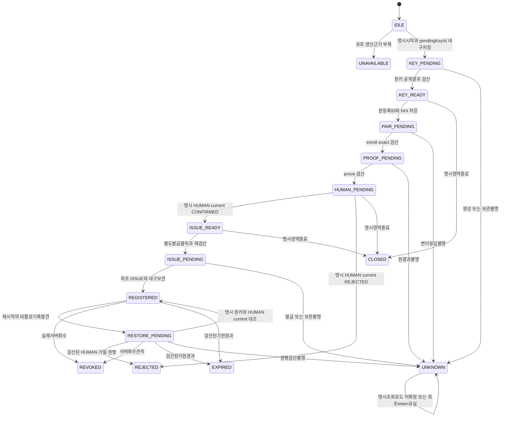

# FN06 desktop 소유 신뢰 등록·보호 caller 후보 r5

2026-11-02. **DRAFT / NOT_ADOPTED / SOURCE_GO_0**. Primary 작성, Main 검토·결정 관리. CANDIDATE 식별자·endpoint·자료형은 새 검토 후보이며 공식 승인 ID/기존 구현이 아니다. 이 본문 하나가 현재 후보 원형이다. 이전 원형은 말미 SHA 이력과 Git checkpoint로만 보존한다.

## 1. 목표·권장 선택·승인 경계

Anvil Windows desktop main이 등록 시작→키 보호→서버 HUMAN 지문 확인→원 발급 결과→등록 관계 보관→명시 복구→native typed 서명을 소유한다. 프로젝트·헌법·지식·권위 이력은 Anvil에 남고 LLM·Agent·계정은 교체 가능한 도구다. 등록 관계를 특정 LLM 계정/세션에 묶지 않는다.

권장은 보호 지속 mapping·명시 재확인 복구와 **신뢰 대안 A: 설치 시 고정한 HTTPS runtime catalogue authority profile**의 조합이다. 사용자 선택은 아직 없다. 대안 B는 부모 고정 release 검증키로 외부 signed catalogue를 검증한다. 일반 코드 배치·타입/함수 구현은 Main 기술선택이며 사람에게 반복 승인 질문으로 넘기지 않는다.

새 선택은 로컬 privileged UI/IPC·보호 지속 metadata/root·전용 signer 설치 신뢰의 source 계약이다. 실제 키/root/ACL·파일·DB/권한·서비스·컴파일/helper·TLS/Agent 실행 승인은 별개다. 이번 작성으로 제품 구현/실제 효과 GO0. source-only/fake compile 결과를 release provenance나 publish-ready로 만들지 않는다. 실제 공급자 부재는 UNAVAILABLE이다.

## 2. 기존 근거와 실제 생산 공백

근거는 `docs/design/Anvil_v3_인터뷰_합의사항.md`의 사용자 소유/최소 손실 교체, `docs/work_packages/FUNCTION_WORK.md` FN06, `docs/contracts/INTERFACES.md` §12.2/14.3, `THREAT_MODEL.md` TM01/TM11, `docs/04_test_reports/AV3/P02/RESULT.md`, 기존 native r2 `docs/contracts/FN06_NATIVE_PREPARATION_AUTHORITY_CURRENT_CONSUME_CANDIDATE_20261102.md`다. P02 계약 수용·FN18/기존 native source 검수는 이 후보의 실제 기능 성공이 아니다.

| 실제 경로·심볼 | 현재 사실·누락 |
|---|---|
| `apps/desktop/src/main.cjs` → `shell.cjs:createShell` | Electron main/local settings/remote WebContentsView. 등록 coordinator 없음 |
| `apps/desktop/src/preload.cjs`, `policy.cjs:assertIpc` | local mainFrame의 get-state/connect/client-quit만. 등록 IPC 없음 |
| `apps/desktop/src/settings.html`, `settings.js` | 서버 주소·명시 연결/종료만 |
| `apps/web/src/features/connections/ConnectionsPage.tsx`, `TrustPanel.tsx`, `trust-api.ts` | registerConnector·최초 코드·HUMAN 지문/범위 확인·회수. 로컬 키/enroll/prove/issue caller 없음 |
| `apps/connector/security/secret-store.ts:WindowsProtectedStore` | 키 생성/공개키/기존 등록 목적 서명·credential 보관/비교. 제품 root/mapping producer 없음 |
| `apps/connector/runtime/windows-host.ts:invokeProtectedHost` | helper hash/path 검사·기존 보호 연산. 자체 새10초/kill을 native에 복사 불가 |
| `apps/connector/native/ProtectedStore.cs` | DPAPI CurrentUser `<keyId>.key` 형식. root는 argv, 제품 root 최초 생산 없음 |
| `apps/connector/runtime/trust-https.ts:TrustHttpsClient` | enroll/prove/exchange/status wire. 제품 조립 없음 |
| `apps/connector/runtime/native-preparation-proof-signer.ts` | private 문맥·mapping/P256/서명/원예산 검산. 실제 resolve/exchange 없음 |
| `apps/connector/native/NativePreparationProofSource.cs:Sign` | 열린 CngKey를 받는 typed primitive. 키/root/caller 생산 아님 |
| `apps/connector/native/NativePreparationOwnerHostSource.cs`, `NativePreparationOwnerPeerSource.cs`, `NativePreparationOwnerBridgeSource.cs` | 원 owner OPEN/QUERY/CLOSE. 별도 signer entry 아님 |
| `apps/desktop/scripts/native-physical-factory-build.cjs` | 부모 snapshot→basis 내장 owner helper→최종 전체hash/ref. signer 설치 publisher 아님 |

전체 등록 caller 예시는 `tests/integration/FN06/windows-https-registration.test.ts:47~56`뿐이다. 그 시험의 root/helper/keyId는 제품 기준이 아니다. 서버 row는 공개 SPKI/지문·등록/connector 세대를 보관하지만 local keyId/root는 모른다. `apps/server/modules/backups/installation-resource-catalog.ts`와 `installation-resource-catalog-provider.ts`는 BACKUP_TARGET/KEY_VAULT용이며 release catalogue로 재해석하지 않는다. 새 signer 설치 upstream/catalogue/profile·로컬 coordinator는 실제 미구현이다.

## 3. 기존 wire·참조·기한을 그대로 소비

`apps/server/modules/connections/registration-protocol.ts`와 `project-registrations.ts`의 원응답을 exact 검산한다.

| 응답 | 정확 성공 자료 |
|---|---|
| enroll | `{status:'HOST_PROOF_REQUIRED',registrationRef,connectorRef,scopeDigest,grants:[],executionAuthorized:false,challenge:{id,payload}}` |
| prove | `{status:'PROVED_WAITING_CONFIRMATION',registrationRef,connectorRef,scopeDigest,grants:[],executionAuthorized:false,observedHostFingerprint}` |
| CHALLENGE | `{status:'EXCHANGE_PROOF_REQUIRED',registrationRef,connectorRef,scopeDigest,grants:[],executionAuthorized:false,challenge:{id,payload}}` |
| ISSUE | `{status:'ISSUED',registrationRef,connectorRef,scopeDigest,grants:[],executionAuthorized:false,scope:'REGISTRATION_STATUS_ONLY',credentialId,credential,expiresAt}` |
| status | `{connectorId,registrationId,generation,status:'REGISTERED_STATUS_ONLY',scope:'REGISTRATION_STATUS_ONLY',publicKeyFingerprint,expiresAt,grants:[],executionAuthorized:false,observedAt}` |

registrationRef.version은 등록 상태 개정, connectorRef.version은 connector generation이며 같은 숫자라고 가정하지 않는다. native credentialGeneration과도 다르다. 기존 hash는 각각 canonical `{registrationId,version,state,scopeDigest}`와 `{connectorId,registrationId,scopeDigest,generation}`다. status에는 fullref가 없으므로 새 fullref를 합성하지 않는다.

challenge.payload.expiresAt은 min(now+120초,등록기한,허가기한)이며 등록기한이 아니다. ISSUE/status의 expiresAt은 credential 기한이다. registrationExpiresAt은 기존 HUMAN view.expiresAt=scope.expiresAt·scopeDigest를 검산한 경우만 채우고 그 전 null이다. challenge/nonce/서명/코드는 private 진행 메모리에만 두고 mapping에 저장하지 않는다.

## 4. 신뢰 A/B와 runtime catalogue authority profile

### 4.1 A — 권장 후보

최초 권위는 사용자가 connect에 입력한 project server URL이 아니다. **설치/build 때 고정되고 부모 package 신뢰에 결박된 runtime catalogue authority profile**이다. 프로젝트 origin 변경은 이 profile의 publisher/origin/TLS를 바꾸지 않는다. profile은 renderer·환경변수·프로젝트 HUMAN/Agent 명령·일반 JSON 파일에서 만들지 않는다. 기존 설치 계약의 승인 package provenance가 profile bytes를 고정해야 한다. 기존 설치 provenance 자체가 부재하면 기본 미등록이며 ‘hash가 있으니 신뢰’로 순환하지 않는다.

profile 후보 exact:

`{schemaVersion:1,purpose:'RUNTIME_CATALOGUE_AUTHORITY_PROFILE',profileId,profileVersion,publisherId,origin,endpointPrefix,tls,roles,platform,maxResponseBytes,maxEntries,maxValidityMs}`

- IDs UUID, version 양의 안전정수. origin은 고정 HTTPS 정규 origin(최대2048자)이며 사용자 connect origin과 별개다.
- endpointPrefix는 고정 `/api/v1/runtime-catalogue/desktop-trust/v1`; GET exact 경로는 prefix+`/<profileId>/<parentReleaseId>`다. 두 UUID 외 query/body/임의 URL/redirect/fallback0. 새 공개 읽기 endpoint 후보이며 현재 없다. credential/cookie/등록코드를 보내지 않는다.
- tls exact `{mode:'SYSTEM_CHAIN_AND_HOSTNAME',minimumVersion:'TLSv1.2',rejectUnauthorized:true}`를 A 기본 후보로 고정한다. 실제 system trust chain+고정 origin hostname을 소비하고 private CA/SPKI pin/새 인증서를 자동 생성하지 않는다. 현재 system trust가 이 publisher 기준을 충족할지는 실제 설치/운영 검토 대상이다. custom CA가 필요하면 profile 별도 변경 결정이며 임의 CA 주입0이다.
- roles exact `['DESKTOP_TRUST_KEY_HOST']`, platform exact `{os:'win32',arch:'x64',runtime:'NET_FRAMEWORK_4_X'}`. 지원 CLR 세부 최소버전은 실제 고정 compiler/reference·설치 검증 산출물이 확정해야 하며 source만으로 지원true0.
- maxResponseBytes=2MiB, maxEntries=64, maxValidityMs=86400000. consumer가 늘릴 입력0이다. 원 요청 총10초/원 남은 예산보다 긴 IO0, response stream bound/abort·late 정착/비밀 없는 고정 오류를 적용한다.

profile/public endpoint는 아직 새 source 계약 후보이며 구현/승인됨이 아니다. catalogue 읽기는 비밀 없는 release metadata만 반환하며 등록/프로젝트 권한을 발급하지 않는다. publish·개정·회수는 보호 배포 producer만 가능하고 이 endpoint에는 쓰기 메서드가 없다.

### 4.2 B — 별도 선택

부모 package에 release 검증 공개키/정확 purpose를 고정하고 외부 signed catalogue를 검증한다. 새 key purpose `ANVIL_DESKTOP_RUNTIME_CATALOGUE_RELEASE`와 서명 envelope/알고리즘·발행 주체·키 보관·교체/유실/회수·복구·rollback·최신성 규칙을 별도로 채택해야 한다. 현재 키/서명 producer는 없다. 오프라인은 마지막 유효 signed catalogue와 high-water를 읽을 수 있지만 expiresAt 뒤 새 helper 진입0, 회수 최신성을 보장할 수 없는 기간을 명시해야 한다. 새 실제키 생성은 제외다.

A는 기존 서버 소유/HTTPS 운영과 연결하기 쉽고 새 release key가 필요하지 않지만 서버/TLS·배포자 침해가 영향을 미친다. B는 오프라인 검증이 가능하지만 새 키 수명·회수 전파·복구 경계가 크다. A 우선 권장은 사용자 선택이나 ‘현재 HTTPS URL이면 충분’이라는 판정이 아니다.

## 5. A catalogue 본문·배포 producer·소비 계약

### 5.1 정확 release 형식 후보

응답 exact `{schemaVersion:1,purpose:'DESKTOP_RUNTIME_CATALOGUE',profileId,sequence,previousRef,releaseRef,snapshot}`. sequence는 publisher/profile 범위의 양의 안전정수, releaseRef는 기존 fullref 형태를 사용하는 새 catalogue 의미다. releaseRef.version=sequence, contentHash=canonical snapshot SHA256, id=snapshot.releaseId. previousRef는 최초 null/이전 catalogue fullref다. 이 ref는 기존 generic/owner factory namespace를 바꾸지 않는다.

snapshot exact:

`{releaseId,releaseVersion,publisherId,profileId,parent,entries,buildEvidence,issuedAt,expiresAt,state,rollbackOf}`

- releaseVersion 양의 안전정수, IDs UUID, state exact ACTIVE/REVOKED, ISO 밀리초 UTC. issuedAt<expiresAt≤issuedAt+24시간. rollbackOf는 null 또는 되돌릴 대상 releaseRef다.
- parent exact `{releaseId,releaseVersion,exeName:'Anvil.exe',exeHash,asarPath:'resources/app.asar',asarHash,headerHash}`. parentReleaseId는 고정 설치 package metadata에서 얻고 renderer가 고르지 않는다. 같은 parent release id/version의 다른hash는 거절한다.
- entries는1..64의 고유 role+fileName. 현재 role은 DESKTOP_TRUST_KEY_HOST 하나이고 fileName은 **AnvilTrustKeyHost.exe** 고정이다. 여분 역할을 빈 성공으로 채우지 않는다.
- entry exact `{role,fileName,bytes,sha256,parentBasisHash,sourceClosureHash,toolchainHash,entryPoint,resourceName,platform}`. bytes는1..64MiB, sha256/hash는 소문자64hex, entryPoint는 새 전용 `DesktopTrustKeyHostSource`, resourceName은 `Anvil.Desktop.TrustKeyHost.ParentBasis.v1`, platform은 profile과 동일하다. entry별 canonical16KiB·전체2MiB 제한을 모두 검사한다. 임의 command/경로/URL/arguments는 없다.
- buildEvidence exact `{sourceCommit,sourceClosureHash,compileInputHash,toolchainHash,buildReceiptRef,verificationReceiptRef}`. sourceCommit40hex, refs 기존 fullref 형태. **필드 모양/해시만으로 실제 build 증거가 되지 않는다.** producer는 아래 보호 원행을 검산해야 한다. 미생산 ref를 가짜로 채우지 않는다.

정확 source manifest/14 owner closure는 signer closure로 자동 재사용하지 않는다. sourceClosureHash는 새 signer entry/ProtectedStore 고정 연산/NativePreparationProofSource·부모/peer 구성의 실제 입력 inventory를 고정해야 한다. 현재 전용 closure/receipt producer가 없으므로 publishable release0이다.

### 5.2 producer→검산→게시

1. 기존 FN18 `verifyPackageHardening`/`verifyPackageForMaker`의 실제 관측 exe/ASAR/header와 **동일 불변 package snapshot**을 먼저 고정한다. source-only verifier 대역 성공을 실제 산출물로 승격0.
2. 그 parent basis를 signer resource에 넣은 정상 compile input을 고정한다. source/tool/reference/cwd·/main·/resource private가 원 inventory에 결박돼야 한다. 실제 compiler 실행은 별도 승인 밖이다.
3. 최종 helper PE/CLI/resource·정확 closure/도구 입력·전체bytes/hash를 검산한다. 출력을 load/실행하는 검증과 data 판독을 구분한다.
4. 보호 build/deployment producer가 **실제 승인 build 원 receipt/검수 원행**과 실제 산출물을 대조해 catalogue revision을 생성한다. 기존 fake compiler/source 테스트에는 이 publisher 경로를 연결하지 않는다. caller `actual:true`, 일반 JSON receipt, 파일해시만으로 게시 자격을 만들지 않는다.
5. 배포 담당 경계의 단일 writer가 expected previousRef/sequence CAS로 게시·개정·회수한다. 프로젝트 DB 정책/HUMAN/Agent/LLM 명령에는 publisher write 경로가 없다. producer/게시 저장소의 별도 배포 주체·파일 소유/권한과 실제 build 증거 reader는 현재 없으며 source 구현/실환경 검증 대상이다. 새 public publish endpoint를 만들지 않는다.

parent package→basis 내장 helper→최종bytes 검산→외부 보호catalogue 게시의 단방향이다. 부모 ASAR에 미래 helper 전체hash를 재내장하지 않는다. raw 외부 catalogue·constructor 옵션은 최초 authority profile을 대체하지 않는다. A에도 배포 upstream이 있어야 하며 현재 부재를 숨기지 않는다.

### 5.3 runtime 소비·개정/회수/rollback

parent main은 설치에 고정된 profile/parent release identity로 정확 endpoint를 읽고 TLS·exact schema·크기/개수·profile/publisher·releaseRef hash·기한·단조 sequence를 검산한다. parent exe/ASAR/header 실관측이 원 parent와 같아야 한다. entry의 고정 역할·helper filename·전체bytes/hash·resource basis·현재 부모/channel을 검산한 뒤만 helper를 시작한다. 다운로드/설치 자동 실행은 이 후보에 없다. 실제 설치가 helper bytes를 공급하지 못하면 UNAVAILABLE이다.

보호 local high-water는 `{profileId,sequence,releaseRef}`를 같은 mapping container에 별도 exact 항목으로 보관한다. 같은 sequence 다른hash/낮은sequence는 거절하고 wall clock 후퇴·응답불명·만료는 닫는다. 최초 high-water도 실제 pinned profile의 유효 응답에서만 만든다. CurrentUser DPAPI 파일의 rollback을 완전히 막는다고 주장하지 않으며 online publisher의 현재 head 검산이 필요하다. 오래된 캐시만으로 새 서명0.

rollback은 낮은 sequence를 수용하는 기능이 아니다. 더 높은 새 catalogue revision이 rollbackOf와 선택한 기존 artifact 전체hash/부모호환을 명시해야 한다. REVOKED release는 신규 helper 진입 차단·진행 권위 폐기이며 실제 프로세스 종료/키삭제 성공이 아니다. 등록/프로젝트 원문·이력은 보존한다. publisher 불명/회수/기한 소진 시 기존 정상 UI/기록 읽기를 보존하되 새 privileged 키/서명 행동은 닫는다.

## 6. 전용 helper·고정 root의 생산 후보

새 internal purpose는 `DESKTOP_TRUST_KEY_OPERATION_V1`, namespace는 `ANVIL_DESKTOP_TRUST_SIGNER_V1` 후보다. 기존 owner factory ref는 native owner 이미지에 그대로 쓰며 signer 인증에 재사용하지 않는다. signer metadata는 catalogue role과 결박한다.

전용 resource exact `{schemaVersion:1,purpose:'DESKTOP_TRUST_SIGNER_PARENT_BASIS',namespace:'ANVIL_DESKTOP_TRUST_SIGNER_V1',signerId,signerVersion,parentExeHash,parentAsarHash,parentHeaderHash}`. 8KiB이하·자기 assembly 정확이름1개·embedded/manifest-contained·외부file/assembly0. private 선언은 고정 compiler/private resource와 최종hash의 build 검산 조건이며 CLR에서 private flag를 조회했다고 주장하지 않는다.

main private attempt→직접 소유 child의 overlapped stdio→전용 helper startup→기존 typed 키 연산 순서다. helper는 자기 basis·자기 전체hash, stdin/stdout pipe의 동일 parent peer PID와 보유 process 시작시각/실image·부모 exe/ASAR/header를 대조한다. 원 OwnerPeer의 실제 kernel 관측/정착 전 handle 보존 알고리즘을 재사용하되 purpose/entry를 분리한다. 일반 Node PID/rawJSON/hash 하나는 인가가 아니다. env는 OS 최소 allowlist 새 객체, cwd 고정 helperdir, 외부 companion/config는 부재만 허용한다. 같은 사용자 전체 메모리 주입·loaded ASAR 전체를 완전 증명한다고 하지 않는다.

root는 Windows `FOLDERID_LocalAppData`의 현재 사용자 KnownFolder 실관측→`<LocalAppData>\Anvil\Trust\v1` 고정 후보다. renderer/환경/userData 옵션에서 받지 않는다. current token SID↔KnownFolder/root 소유 SID·각 부모/root nonlink/reparse·정규경로·보유 handle identity를 검산한다. 기존 일반폴더를 자동 채택/수리하지 않는다. 최초 명시 생성은 사용자/SYSTEM 전용 DACL·상속차단 후보를 실제 handle로 재검산하며 구체 OS API/기업환경 호환은 Main 기술검토로 닫는다. 생성/ACL 실제 실행은 별도 승인 밖이다.

helper도 보호 startup 뒤 같은 KnownFolder/current SID에서 root를 도출하고 main의 private root volume/file identity와 비교한다. root path는 IPC/record에 넣지 않는다. 별도 root registry/원격선택0. 기존 `<keyId>.key`와 DPAPI CurrentUser entropy/키형식은 유지한다. 개인키를 Node/renderer로 반환하지 않는다.

전용 helper의 privileged 연산은 기존 CREATE_KEY/PUBLIC_KEY·등록 목적 SIGN_PROOF·StatusOnly STORE_CREDENTIAL/CREDENTIAL_MATCHES와 별도 typed SIGN_NATIVE_PREPARATION_PROOF로 한정하는 후보다. 기존 ProtectedStore의 공개 입력을 범용 확장하지 않고 보호 entry 안에서 목적/키/current를 검산한다. 평문 credential getter·범용 bytes signer0. 기존 C# `Sign(frame,existingKey)` primitive만으로 이 caller 보호가 완성되지 않는다.

## 7. 정상 사용자 흐름·HUMAN project 검산

1. 접힌 local settings를 열어도 IO0. 명시 시작 시 pinned catalogue/profile·root/helper 보호를 검산한다. 미충족이면 키 생성 전 UNAVAILABLE.
2. main이 pendingKeyId UUID를 정해 KEY_PENDING을 내구 저장한다. 성공 뒤 기존 키 생성 최대1회. 공개키/지문/P256 검산 후 KEY_READY를 보관·표시한다.
3. 사용자가 기존 UI11에서 공개 지문을 비교·입력해 HUMAN 등록 요청을 저장한다. 키 보유만으로 서버 등록/HUMAN 확인 완료0.
4. local에 projectIdHint UUID·원 registrationId UUID·최초 oneTimeCode43을 제시한다. hint는 권위가 아니다. main이 고정 origin/현재 remoteSession에서 정확 HUMAN GET `/api/v1/projects/<projectIdHint>/connector-registrations/<registrationId>`만 수행한다. query/body/임의URL/header/redirect/fallback0. cookie/CSRF 원문 export0.
5. 기존 `trust-api.ts:readHumanRegistration/validateTrustView`와 같은 project/ID·fullref/hash·scope.projectId/installationId·scopeDigest·키지문·등록기한을 검산한다. 조회 실패 시 다른 project 탐색0. projectId는 성공 뒤에만 hint와 같은 검산 UUID로 보관한다. 일반 renderer snapshot을 보호 응답으로 신뢰0.
6. 원 등록 ID/hint를 먼저 보관하고 코드는 private 진행 메모리에서만 enroll→기존 등록 proof→prove로 소비한다. enroll scopeDigest는 HUMAN scope canonical hash와 같아야 한다. 응답의 원키·installation·범위·세대를 대조한다.
7. 기존 UI11 HUMAN이 지문/범위/기한을 별도 확인한다. 명시 current 조회에서 CONFIRMED를 검산한 뒤 로컬 발급 버튼을 활성화한다. 클릭 시 다시 current·원예산/기한을 검사하고 서버가 최종 host ISSUE를 인가한다.
8. ISSUE 최초 credential은 기존 StatusOnly 보호 저장에 최대1회 전달하고 원결과/보관 readback을 검산한 뒤 REGISTERED를 보관한다. 유실은 UNKNOWN·자동재발급/새키0.
9. native mapping은 원키·등록·profile/current·별도 NATIVE_ONLY 권위를 모두 검산한 경우만 공급한다. native sign은 challenge→sign→consume보다 앞이며 consume 뒤 factory ticket으로 서명 선행인가를 만들지 않는다.

projectId는 enroll/issue/status DTO에 없고 scopeDigest 역산 불가다. 대안인 원 scope 전체 입력은 hash 대조 가능하지만 입력량/오염면이 커 projectIdHint를 권장한다. main의 고정 HUMAN GET transport는 아직 없다. 지정 로그인 remoteSession의 고정 endpoint 소비를 구현해야 하며 불가능하면 RESTORE_UNAVAILABLE이다. 일반 cookie getter/임의 fetch/새 HUMAN write 대행을 추가하지 않는다. NativeAuthority 값을 HUMAN 등록 GET에서 만들지 않는다.

native는 기존 signer private context의 동적 remaining·고정 callExpiresAt·등록/profile/credential 최소기한을 좁혀서만 쓴다. 새 helper 진입마다 10초0. 등록 단계도 원 요청 상한10초/최소기한을 유지하고 pending IO/외부 효과를 단순 abort로 종료 완료라 하지 않는다. 여러 명시 사용자 단계는 별도 요청이되 오래된 challenge/원명령을 새 기산점으로 연장하지 않는다.

## 8. 보호 지속 mapping과 휘발 대안

지속안을 권장한다. 휘발 대안은 저장 계약을 줄이지만 재시작UNAVAILABLE/복구미구현이며 원키가 남아도 자동연결0이다. 어느 안도 자동 재생성/재발급·원행 삭제로 복구하지 않는다.

### 8.1 정확 record

`{schemaVersion:1,purpose:'DESKTOP_TRUST_KEY_BINDING',bindingId,revision,previousHash,attemptId,origin,label,pendingKeyId,projectIdHint,projectId,key,registration,credential,profile,state,uncertainStep,createdAt,updatedAt}`

IDs UUID, revision 양의안전정수, previousHash 최초null/후속 직전 canonical record SHA256. 시간 밀리초 UTC ISO/createdAt≤updatedAt. origin 기존 정규 HTTPS 최대2048자, label1..200자. pendingKeyId는 KEY_PENDING 전 main이 선택해 불변이며 renderer응답0.

- key null 또는 exact `{keyId,publicKeySpki,fingerprint,signerImageHash}`. keyId=pendingKeyId, 기존 canonical P256 SPKI·SHA256·catalogue signer 전체hash. 검산 전 SPKI/지문은 null, placeholder0.
- registration null 또는 exact `{registrationId,registrationRef,connectorRef,scopeDigest,installationId,lastServerState,registrationExpiresAt}`. state는 null/CREATED/CHALLENGED/PROVED_WAITING_CONFIRMATION/CONFIRMED/REJECTED/ISSUED/REVOKED. REGISTERED_STATUS_ONLY를 여기에 넣지 않는다.
- credential null 또는 exact `{credentialId,digest,expiresAt,storageState}`. state STORED/STORE_UNKNOWN. raw av3ct1은 mapping0, 별도 기존 DPAPI 저장에만 전달한다.
- profile null 또는 exact `{channelProfileRef,expiresAt}`. 실제 native 보호 supplier가 교차검산한 것만 보관한다. null로 native 허가0.
- uncertainStep null 또는 KEY_CREATE/ENROLL/PROVE/ISSUE/CREDENTIAL_STORE/MAPPING_STORE.

| 저장state | key | hint/project | registration nullable | credential/profile |
|---|---|---|---|---|
| KEY_PENDING | null, pendingKeyId 필수 | null/null | null | null/null |
| KEY_READY | 필수 | null/null | null | null/null |
| PAIR_PENDING | 필수 | hint필수/project는 검산전null | 원ID필수·나머지 응답전null | null/null |
| PROOF_PENDING | 필수 | hint필수/project 검산전null허용 | enroll refs/scope/installation/CHALLENGED 필수·등록기한 HUMAN 전null | null/null |
| HUMAN_PENDING | 필수 | 위와 동일 | prove 원refs/scope/installation/state 필수·등록기한 HUMAN 전null | null/null |
| ISSUE_READY | 필수 | 둘다 검산UUID | HUMAN CONFIRMED·등록기한·원scope/refs 모두필수 | null/null |
| ISSUE_PENDING | 필수 | 위와 동일 | 원검산값 보존 | null/null |
| REGISTERED | 필수 | 둘다검산UUID | ISSUE refs/ISSUED·앞 HUMAN 등록기한 보존 | STORED필수/profile null허용 |
| REJECTED | 필수 | 검산UUID | HUMAN REJECTED 원상태·정확 registrationRef/connectorRef·scopeDigest/등록기한 보존 | credential null/profile null·uncertainStep null |
| REVOKED | 필수 | 검산UUID | HUMAN REVOKED 관측 | 과거값/null·profile null |
| EXPIRED | 필수 | 원보관값 | 원관측/기한보존·미확인기한으로 판정0 | 과거값/null·profile null |
| UNKNOWN | 이전key/null | 이전값 | 원ID/관측값만·refs/기한null허용 | 이전값/STORE_UNKNOWN허용·profile null |

KEY_PENDING 내구 저장/sync/readback/CAS 성공 전 CREATE_KEY0. 생성 뒤 결과/보관 불명이면 기존 pendingKeyId로 명시 PUBLIC_KEY만 가능하며 CREATE_KEY 재호출/자동새ID0. 키 미발견/조회실패도 ‘생성안됨’ 확정0. 원 helper/root 검산 전 PUBLIC 조회0.

원 ID/hint는 ENROLL 전 보관하고 코드는 저장0. enroll/prove 원응답과 HUMAN scope를 교차검산해 필드를 채운다. 같은 id/version 다른hash 거절. status generation으로 등록 version/ref를 만들지 않는다. ISSUE/current 기한은 과거 관측이며 저장상태가 fresh 인가가 아니다. profile 부재·StatusOnly 파일을 native bearer로 사용0.

### 8.2 한도·CAS·원자 보관

root metadata 고정파일은 `bindings.v1`, `bindings.v1.previous`, 단발 `bindings.v1.next`, `bindings.v1.lock`뿐이다. container ciphertext16MiB·1024개 logical revision rows·각canonical record16KiB, 모두적용. 기존 키/credential파일은 별도 합계1024개/16MiB한도. 자동삭제/close예약0이며 포화시 새 회수사실 기록도 거절할 수 있다. 원행조회·서버현재회수는 보존하고 새서명은 닫는다.

container plaintext exact `{schemaVersion:1,purpose:'DESKTOP_TRUST_BINDINGS',sequence,previousHash,catalogueHighWater,rows}`. highWater는 null 또는 exact `{profileId,sequence,releaseRef}`. rows는 불변revision, 연속/previousHash전수검산. root 범위 단일writer/create-new lock, stale lock 자동탈취0. 정확 oldcontainer hash/sequence·binding revision CAS. 같은 사용자 DPAPI가 antirollback 전체보장 아님.

새 metadata 목적 entropy로 CurrentUser protect→next create-new/write/sync→같은 handle 길이/hash·unprotect/canonical 관계readback→원본CAS 재검산→same-volume atomic replace/이전본보존→원본/부모내구readback 후보순서다. 실제 Windows replace/directory durability는 구현/실검증전 NOT_RUN. 실패시 원본/previous/next를 자동삭제·previous를 최신으로 채택0, UNKNOWN보존. 소유/링크/handle변경은 쓰기전후 거절한다.

HUMAN 고정 보호 GET의 exact/hash/scope 검산을 통과한 REJECTED는 명확한 사람 거절이다. 저장state/lastServerState/화면phase를 REJECTED로 보존하고 problem=SERVER_REJECTED·recoveryAvailable=false로 표시한다. 원키·원ID·정확 fullref·scope/기한을 지우거나 UNKNOWN으로 바꾸지 않는다. 이 시도에서 ISSUE/새 키/자동 재등록은 차단하며 기존키로 발급 준비를 다시 열지 않는다. 반대로 CONNECTOR_REGISTRATION_NOT_PENDING 같은 오류 코드만으로 REJECTED를 추정하지 않는다. 원행 검산 또는 보관 결과가 불명이면 UNKNOWN과 그 원 uncertainStep을 유지한다.

## 9. 재시작·불명·회수

재시작은 보호root/container/고정파일형식·상한·DPAPI/chain부터 비활성복원한다. 키/네트워크 자동시작0. KEY_PENDING/UNKNOWN-KEY_CREATE는 명시기존키확인에서 원pendingKeyId의 PUBLIC 결과와 helper/root를 대조한다. 키를 찾아도 HUMAN 원등록 재확인 없이 ISSUE_READY/REGISTERED승격0.

PAIR_PENDING/PROOF_PENDING/HUMAN_PENDING은 원ID/hint의 고정 HUMAN GET만 명시수행한다. 저장하지 않은 코드/nonce를 재구성해 enroll/prove/issue 자동재개0. ISSUE_PENDING/UNKNOWN-ISSUE는 서버가ISSUED여도 최초token복구라 하지 않는다. 새ISSUE/새키0. 보관성공 원credential이 검산되는 경우만 기존결과를 대조하며 plaintextRead API0.

REGISTERED 복구는 원키/SPKI지문·project/등록/세대/scope·HUMAN current로 등록관계만 재확인한다. 기존 credentialMatches는 bearer HTTP status를 수행하는 포트가 아니다. 재시작후 실제 StatusOnly credential 재사용은 별도 보호 use-without-return producer가 아직 없으므로 완료약속에서 제외한다. native slot/profile/NativeAuthority도 복구했다고 하지 않는다.

회수/만료/옛세대·다른사용자·키/root부재·변조·조회불명은 비활성/UNKNOWN. 서버회수는 기존 HUMAN revoke 명령이며 로컬삭제와 다르다. 원프로젝트/등록이력·키/credential을 자동삭제0. 명시제거는 별도 소유/참조/정리 계획을 소비한다. issuer 결과유실·mapping보관실패는 발급실패로 위장하지 않고 원결과를 보존한다. UNKNOWN 상태에서 자동재전송/재발급0.

## 10. 닫힌 IPC·상태·오류

새 privileged IPC 후보다. own data/exact keys만 허용, getter/prototype/extra 거절. 정확 local settings sender+mainFrame+LOCAL_URL·소유window/origin/auth관측 epoch를 main이 검산한다. remote renderer/iframe/다른창0. renderer가 root/keyId/hash/actor/profile/URL/header/token을 선택하지 않는다.

| method후보 | exact 요청 |
|---|---|
| trust-status | `{attemptId:null 또는 UUID,epoch:null 또는 양의정수}`. 최초는 둘다null. 로컬상태만·키/네트워크IO0 |
| trust-begin | `{requestId,epoch,confirmNewKey:true,label}` |
| trust-pair | `{requestId,attemptId,epoch,projectIdHint,registrationId,oneTimeCode}` |
| trust-act | `{requestId,attemptId,epoch,action}`. CHECK_CURRENT / ISSUE / RESTORE_VERIFY / CLOSE만 |

requestId/attemptId UUID·epoch양의안전정수. main이 attempt/epoch발급. 성공 exact `{ok:true,state}`. state exact:

`{schemaVersion:1,contextEpoch,attemptId,phase,origin,label,publicFingerprint,projectIdHint,projectId,registrationId,registrationRef,connectorRef,registrationExpiresAt,credentialExpiresAt,problem,recoveryAvailable}`

origin은 기존 연결고정값/미연결null. refs/hash/ISO/UUID는 기존원형, recoveryAvailable boolean이며 true는 복구버튼 가능성이지 권위가 아니다. phase는 아래 표 enum, problem은 null/고정오류. publicFingerprint=검산key지문/null. privatependingKeyId/keyId/root/SPKI/코드/서명/credential/rawerror는 응답0.

| 화면phase | attempt/label/지문 | project/등록/refs·기한 | problem/recoveryAvailable |
|---|---|---|---|
| IDLE/UNAVAILABLE | 모두null | 모두null | IDLE null/false, UNAVAILABLE PROTECTION_UNAVAILABLE/false |
| KEY_PENDING | attempt/label필수·지문null | 모두null | null/false |
| KEY_READY | 모두필수 | 모두null | null/false |
| PAIR_PENDING | 모두필수 | hint/원등록ID필수·검산전project/refs/기한null | null/false |
| PROOF_PENDING/PROOFED_WAITING_HUMAN | 모두필수 | hint/원refs필수·project/등록기한 HUMAN전null·credential기한null | null/false |
| READY_TO_ISSUE/ISSUE_PENDING | 모두필수 | 검산project/refs/등록기한필수·credential기한null | null/false |
| REGISTERED | 모두필수 | 모두필수 | null/false. 현재 활성/실행 성공 아님 |
| RESTORE_PENDING | 원보관값/null조합그대로 | 원보관값/null조합그대로 | null 또는 RESTORE_UNAVAILABLE/true |
| REJECTED | 원보관값 | HUMAN 거절의 검산된 project/원ID/fullrefs/등록기한 보존·credential기한 null | SERVER_REJECTED/false |
| REVOKED/EXPIRED | 원보관값 | 원보관값 | CONTEXT_CHANGED 또는 DEADLINE/false |
| UNKNOWN | 원보관값·키생성불명지문null허용 | 원보관값·가짜refs/기한0 | OUTCOME_UNKNOWN/false |
| CLOSED | attempt만유지·label/지문null | 모두null | null/false |

HUMAN_PENDING저장→PROOFED_WAITING_HUMAN화면, ISSUE_READY→READY_TO_ISSUE화면이다. 등록기한null은 ‘등록기한 아직미확인’, 키결과null은 ‘키생성 결과미확인’. challenge/credential기한으로 등록기한대체0.

실패 exact `{ok:false,error:{code}}`. 허용code는 IPC_DENIED / INPUT_INVALID / CONTEXT_CHANGED / BUSY / PROTECTION_UNAVAILABLE / SERVER_REJECTED / DEADLINE / OUTCOME_UNKNOWN / RESTORE_UNAVAILABLE뿐이다.

| 원고정오류 | 로컬분류 |
|---|---|
| CONNECTOR_HUMAN_CONFIRMATION_REQUIRED | SERVER_REJECTED·HUMAN대기유지 |
| CONNECTOR_REGISTRATION_NOT_PENDING, CONNECTOR_ENROLLMENT_ALREADY_USED, CONNECTOR_CHALLENGE_EXPIRED, CONNECTOR_CHALLENGE_NOT_PENDING, CONNECTOR_PROOF_NOT_PENDING, CONNECTOR_PROOF_ATTEMPT_LIMIT, CONNECTOR_FRESH_CLIENT_NONCE_REQUIRED, CONNECTOR_HOST_OR_CODE_MISMATCH, HOST_PROOF_INVALID, CONNECTOR_PROTOCOL_INPUT_INVALID, INPUT_INVALID | SERVER_REJECTED·원입력/record보존 |
| CONNECTOR_BASIS_NOT_CURRENT, CONNECTOR_CREDENTIAL_INVALID, CONNECTOR_CREDENTIAL_SCOPE_DENIED, CONNECTOR_CREDENTIAL_REQUIRED, NOT_FOUND, AUTH_REQUIRED | CONTEXT_CHANGED·현재접근폐기 |
| ALREADY_ISSUED_RECONCILE, CONNECTOR_EXCHANGE_RECONCILE_REQUIRED | OUTCOME_UNKNOWN·재발급0 |
| CONNECTOR_HTTPS_TIMEOUT | DEADLINE·변이출발뒤 저장phase UNKNOWN |
| ORIGIN_INVALID, CONNECTOR_TLS_FAILED, CONNECTOR_REDIRECT_DENIED | PROTECTION_UNAVAILABLE·자동origin교체0 |
| CONNECTOR_REGISTRATION_INTEGRITY_FAILED, CONNECTOR_RESPONSE_INVALID, CONNECTOR_REQUEST_FAILED, CONNECTOR_RESULT_UNKNOWN, 그밖모든오류 | OUTCOME_UNKNOWN·raw body/exception/stack0 |

contextEpoch는 serverorigin/window/remoteView/auth관측/binding변경때 증가한다. A→B→A도 새epoch. 각await뒤 동일포트/epoch/origin·원budget/최소기한재검산. 폐기요청은 새GET/POST0, 옛finally가현재latch변경0. 이미출발한변이는원UNKNOWN보존. 창닫기=숨김은기존유지, 등록영역CLOSE는원진행권위회수/입력폐기이며 외부정리완료아님.

requestId는 attempt안 exactcanonical요청hash/진행결과와결박. 코드있는hash/journal은private메모리만·영속코드/hash저장0. 동일ID/동일요청 동시는한효과의pending결과를기다리고 다른요청은INPUT_INVALID. 결과재조회는비밀없는state만. ISSUE불명에같은ID도재전송0. epoch폐기뒤옛ID는CONTEXT_CHANGED. 재시작메모리journal부재를새효과허가로사용0. 최대256entries/attempt, 포화BUSY/자동정리·새attempt우회0.

## 11. 문서 wireframe·상태그림 — 전부 CANDIDATE

기존 connect/종료/창숨김·remote WebUI를 유지한다. 새메뉴/대시보드/실prototype0. `CANDIDATE-LOCAL-TRUST-01`은 검토용 식별자다.

```text
┌ Anvil 개발 클라이언트 · 설치형 Shell ────────── [ⓘ] [클라이언트 종료] ┐
│ 서버 기본주소 [기존입력] [명시 연결/재연결]                          │
│ 기존 연결/오류 표시                                                  │
│ ▸ 이 PC 신뢰 등록   마지막 로컬기록상태                              │
├────────────────────────────────────────────────────────────────────┤
│ 기존 원격 WebUI: 기존 로그인 / 프로젝트 / UI11                       │
└────────────────────────────────────────────────────────────────────┘
```

```text
▾ 이 PC 신뢰 등록                                      [영역 닫기]
  프로젝트 연결서버: 기존고정origin (publisher권위profile과별개)
  상태: 공개키 준비됨 / 서버 HUMAN 확인필요
  표시이름 [1..200자]
  공개지문 [64hex·읽기전용·줄바꿈]                         [복사]
  ⓘ 등록기록은 실제쓰기·실행·회수완료를 뜻하지않습니다.

  ① 기존 WebUI 프로젝트→연결·환경(UI11)에서 예상지문 비교·등록저장
     [연결·환경으로 이동: 검산project있을때만]
  ② 최초코드와 원등록ID를 아래에 직접제시
  서버프로젝트 ID [UUID·선택힌트·검산전권위없음]
  등록 ID          [UUID]
  일회코드         [숨김·자동완성/보관없음]
  [등록 증명 보내기]   [현재 상태 확인]
  HUMAN대기: 서버화면에서 관측지문/범위/기한을 명시확인
  [서버 확인 화면으로 이동]   [로컬 등록으로 돌아오기]
  [발급 요청 보내기: CONFIRMED/current검산전 비활성]
  고정오류/미확인사유·원입력보존
  ▸ 정확참조·기한 (공개자료만, 등록기한null이면 아직미확인)
```

이동은 고정projectorigin의 `#/projects/<검산projectId>/connections`만. hint로이동0, 검산project없으면기존WebUI수동탐색. 돌아오기는localfocus/펼침만·POST0. 입력있는영역닫기는명시폐기확인, 코드전송뒤/회수때코드폐기. 창숨김은다른의미다.

```text
재시작: 기존기록 발견 · 현재권위미확인
[기존 등록 다시 확인] [서버 확인 화면으로 이동]
새키/발급 자동수행없음. StatusOnly credential활성/native권위는별도미확인.

REJECTED: 서버에서 사람이 등록을 거절함 · 정확 원등록 이력 보존
[현재 상태 확인] [발급:비활성] [새키/자동재등록:차단]
명확한 거절을 발급결과 불명으로 표시하지 않습니다.

UNKNOWN: 발급 또는 저장결과미확인 · 원시도보존
[현재 상태 확인] [발급:비활성] [새등록:비활성]

포화/손상: 원기록보존·신규쓰기차단, 자동삭제/덮어쓰기우회없음.
```



REGISTERED는StatusOnly등록관계이력이다. native사용가능/Agent실행으로가는화살표없음. PENDING/UNKNOWN재시작자동재개0. 화면전이와IO정착/외부회수완료는구분한다.

## 12. source 업무·설계→기능→시험 추적

기존변경후보는 `apps/desktop/src/{main,shell,preload,policy}.cjs`, `settings.html`, `settings.js`; `apps/connector/security/secret-store.ts`; `apps/connector/runtime/windows-host.ts`, `native-preparation-proof-signer.ts`; `apps/connector/native/ProtectedStore.cs`, `NativePreparationProofSource.cs`다. 신규 catalogue profile/producer/reader·전용 signer entry/peer/basis/build verifier·KnownFolder/root·main coordinator·binding store/시험은 후속WI에서최소분리한다. 이문서는파일쓰기허용목록이아니다.

| CANDIDATE 설계 | 화면/기능 | 필수합성검증 |
|---|---|---|
| OWNER-01 | main등록조립·계정독립 | 실제IPC→main coordinator, LLM계정입력의존0 |
| CATALOGUE-A-01 | 고정authorityprofile·읽기endpoint·보호publish | projectorigin으로publisher교체0·잘못TLS/profile/role·fakebuild게시0 |
| CATALOGUE-A-02 | release개정·회수·rollback/highwater | 같은sequence다른hash/낮은개정·만료·회수·오래된캐시거절 |
| IPC-01 | 접힘/명시4method | 열기IO0·remote/iframe/다른창거절·ABA/늦은finally폐기 |
| ROOT-01 | KnownFolder/SID·고정root | env/renderer경로0·owner/link/handle변경·불명거절 |
| SIGNER-01 | 단방향build/entry·원typedSign | ownerfactoryref오용0·원예산/lateIO·자기선언parent0 |
| ENROLL-01 | 지문→UI11→pair/prove→current | 원ID/hint·refs없는status·HUMAN전ISSUE0·등록기한null·HUMAN REJECTED 원상태/fullref 보존·UNKNOWN과 구분·ISSUE/새키/자동재등록0 |
| ISSUE-01 | 별도발급·UNKNOWN보존 | 동시효과1·유실재발급0·token로그/재조회0 |
| STORE-01 | pendingKeyId전보관·container/CAS | 생성전내구실패key0·nullable·잘림/포화/원행보존 |
| RESTORE-01 | 명시기존키/HUMAN재확인 | 원pendingKeyId PUBLIC만·회수/옛세대·새키/ISSUE0 |
| NATIVE-01 | 원mapping→signer | StatusOnly/consume뒤ticket오용0·profile없음닫힘·새10초0 |
| NAV-01 | 기존UI11왕복/로컬focus | 임의URL/hint이동0·자동POST0·connect/종료/숨김보존 |

필수정상은 실제local handler→main→등록leaf→HUMAN확인원응답→원보관/재시작→native mapping/typedhelper의실소비다. fakeprofile/verifiedtrue/미사용wrapper0. 시험은명시fake host/transport/FS·고정시험키만으로source경계를검산할수있지만 actualDPAPI/ACL/KnownFolder/pipepeer/CNG·C#compile·패키지설치·TLS/DB/서비스/Agent는별도NOT_RUN이다. 모든출력은한국어·비밀없이고정오류이며메모리PASS를실제release/provenance/인가로승격0.

## 13. 결정과 구현 준비 판정

한번의source계약선택으로검토할권장범위는 A catalogue authority profile/보호publisher·전용signer단방향설치·고정root/보호지속mapping·닫힌local UI/IPC·명시복구다. 기존서버등록/nativewire/DPAPI키형식·프로젝트권한/DB schema는변경하지않는다.

새결정인근거: 현재desktop에privileged등록IPC가없고, 서버등록자료에localkey/root복구관계가없으며, 기존설치upstream이전용signer최종hash를공급하지않는다. A는새읽기endpoint·배포producer/지원profile·보호metadata수명을구체화한다. B를선택하면새releasekey/purpose·교체/회수/오프라인규칙을추가로결정해야한다. 실제key는두안모두생성0.

KnownFolder/ACL API구현·고정session의HUMAN GET·C#자료구조·파일배치는Main기술검토/독립검수로닫는다. 아직없는upstream을있는것처럼전제하지않는다. 실제환경의publisher주체/설치provenance·platform지원/OS한계는source구현만으로입증불가다. 후보는검토가능한정확안이며아직채택/구현GO가아니다. 실제효과를허용하려면후속정확실행범위를별도로대조한다. 전체FN06/계획은미완료다.

## 14. revision 이력

- r1 SHA `7DCEA96A86836419183EC96AADBF9945600AFA176CEFF727783D2F99395A58D2`: 최초 A/B·로컬경계후보.
- r2 SHA `B5A1EFE7D321372301F4879687068770ED17BCE1D848E50E4761414BA80E977C`: 화면/IPC·보호생산·저장상세. 독립C0/I3의기한/projectlocator/키생성전기록문제가있었음.
- r3 SHA `B4F40A9689240E90F83CABB388BB3F99C534FA2FD2F4897A8216F97E12480A74`: I1~I3보완·helper단방향·upstream부재공개. DRAFT checkpoint `49f47b720ad1fa5179d5f5c6ab26e6c287c99cc1`에원문보존.
- r4: 오류원형누적/뒤절대체방식을버리고현재본문하나로통합. projectorigin과publisherauthority분리·A/B최초신뢰·catalogueproducer/개정/회수/rollback·유한형식구체화. 모든revision은미채택후보이며과거원형으로구현하지않는다.
- r5: r4 SHA `BB4B9219497B1A6209622C58D256AF581210D2633E79CA667C32A463C9AEF1C1`의 독립 I1을 보정했다. 기존 HUMAN REJECTED 원상태/fullref를 비활성 저장·화면에 보존하며 UNKNOWN과 구분한다. ISSUE/새키/자동재등록 차단·NOT_ADOPTED/GO0·나머지 신뢰 선택은 유지한다.
